.. This page is generated by tools/sync_from_code.py from docs/vet_clean/SCHEME.md of the code
   repository. Edit the Markdown there and re-run the script.

Properties
==========

What each property means, how the scheme achieves it, and the test that shows it
(:doc:`tests`; worked notebooks in :doc:`gallery`).

Each property is stated as it holds with the production keys of the templates, with the
reason it holds, where it stops holding, and the test in ``tests/vet_clean`` that checks it.
"Exact" means to round-off.

+--------------------------+------------------------------------------------------------------+
| property                 | status                                                           |
+==========================+==================================================================+
| energy (gas + radiation) | exact; floors are paid from the radiation                        |
+--------------------------+------------------------------------------------------------------+
| mass                     | exact                                                            |
+--------------------------+------------------------------------------------------------------+
| angular momentum L_z     | cubed sphere: exact (no ledger); spherical polar: exact except   |
|                          | where the face-flux cone cut acts (booked in a ledger; a fix is  |
|                          | in progress)                                                     |
+--------------------------+------------------------------------------------------------------+
| linear momentum          | not conserved in general: the cone cut, the well-balancing       |
|                          | residual and the floor velocity rules change it (not booked);    |
|                          | gravity is a source; not a discrete invariant on spherical-polar |
|                          | / cubed-sphere meshes                                            |
+--------------------------+------------------------------------------------------------------+
| positivity               | density by construction; E by the implicit operator and Zalesak  |
|                          | limiters, with counted backstops; gas internal energy not by     |
|                          | construction (the step is redone, or the radiation pays)         |
+--------------------------+------------------------------------------------------------------+
| well-balance             | equilibrium envelopes stay at rest to about 1e-9 of the sound    |
|                          | speed                                                            |
+--------------------------+------------------------------------------------------------------+
| order                    | successive orders of the finest pair: 1.8 (time ladder of deck   |
|                          | D), 1.9-2.2 (grid + time ladder of a linear wave); first order   |
|                          | in time where the gas-radiation exchange is stiff                |
+--------------------------+------------------------------------------------------------------+
| radiation-acoustic waves | phase speed and damping right in every trapping regime           |
+--------------------------+------------------------------------------------------------------+
| diffusion limit          | the right diffusion coefficient at any cell optical depth        |
|                          | (asymptotic preserving)                                          |
+--------------------------+------------------------------------------------------------------+
| moving media             | radiation advected with the gas; comoving diffusion Galilean     |
|                          | invariant                                                        |
+--------------------------+------------------------------------------------------------------+
| restart, dt retry        | bitwise                                                          |
+--------------------------+------------------------------------------------------------------+
| reproducibility          | bitwise across rank counts; across tile layouts with the         |
|                          | conditions below                                                 |
+--------------------------+------------------------------------------------------------------+
| CPU / GPU                | agreement to round-off, not bitwise                              |
+--------------------------+------------------------------------------------------------------+
| no silent fallbacks      | every change of method prints or stops the run                   |
+--------------------------+------------------------------------------------------------------+
| phi mirror symmetry      | exact on wedges of whole azimuthal periods; on narrow wedges     |
|                          | with ``vet_gd_wall_sym``                                         |
+--------------------------+------------------------------------------------------------------+
| meshes                   | Cartesian, spherical polar, cubed sphere; one implementation     |
+--------------------------+------------------------------------------------------------------+

Energy (gas + radiation): exact
~~~~~~~~~~~~~~~~~~~~~~~~~~~~~~~

:math:`E` is updated in flux form with one energy flux per face, shared by the two cells. The gas
takes exactly the energy the radiation gives up in each cell, including the kinetic energy of
the radiation force, and any later correction to :math:`E` is moved to the gas with the opposite
sign. The positivity limiters scale a face's flux on both sides at once. The density,
pressure and radiation floors take the energy they need from the radiation of the same cell
or its radial column (``<hydro>/floor_pay = rad_column``, ``implicit_pos_floor_cons``).
With ``floor_pay_skip = true`` (production) the energy changed by the density floor and the
velocity ceiling is paid as well. The initial conversion's floors are paid before the t = 0 output.
With ``<hydro>/floor_from_ekin`` (general EOS) a fast cell pays its floor deficit from its own
r / theta kinetic energy instead (E kept, :math:`L_z` kept: the phi momentum is never scaled).
Energy is created only when a column holds too little radiation to pay; each such event
prints a ``CLEAN WARNING``.

Test: ``conservation_sp``, ``conservation_cs`` (closed rotating shells, dE/E <= 1e-13; measured
about 1e-15), ``thermal_eq``, and ``floor_pay`` (general EOS with a temperature floor that acts in
most cells every cycle, paid from the radiation: dE/E <= 1e-13 from t = 0; and with
``floor_from_ekin`` and a velocity ceiling below the shell's speeds: dE, dM, dLz <= 1e-13).

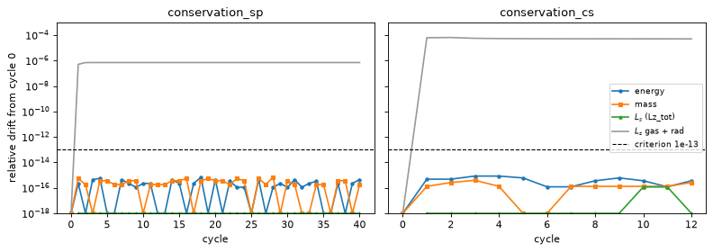

   Relative drift of total energy, mass and ``Lz_tot`` from cycle 0 on the closed rotating shell (left spherical polar, right cubed sphere; grey: gas + radiation L_z without the ledger). Pass: energy, mass and ``Lz_tot`` below 1e-13 (dashed).

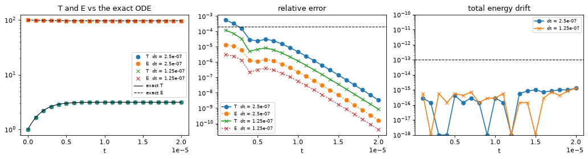

   Gas temperature and radiation energy relaxing to equilibrium against the exact ODE at two time steps (left), their relative errors (middle) and the total-energy drift (right). Pass: T error below 2e-4 (dashed), order >= 1.8, energy drift below 1e-13 (dashed).

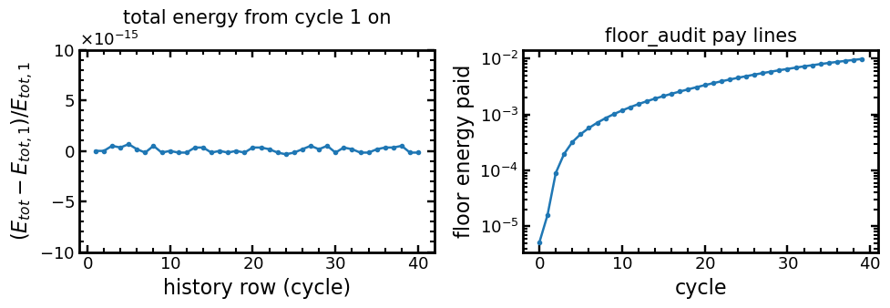

   A temperature floor that acts in most cells every cycle, paid from the radiation: total-energy drift from cycle 1 on (left) and the floor energy paid per cycle (right). Pass: drift below 1e-13, energy paid > 0, unpaid 0, no ``CLEAN WARNING``.

Mass: exact
~~~~~~~~~~~

The radiation solve never changes the density, so mass conservation is that of the hydro,
which is in flux form.
With ``<hydro>/dfloor_flux_limit`` the outflow of a nearly empty cell is scaled back so that its
density cannot fall below the floor, and both neighbours see the same scaled flux; the density
floor of the primitive-variable recovery stays as a backstop (counted in the event log). The
held gas then also moves only as fast as its scaled flux: the cell's momentum, except its L_z
part, is scaled by the same factor at fixed total energy (the kinetic energy becomes heat).
Without this, gravity and pressure would keep accelerating gas whose work (carried by the mass
flux under ``etotgrav``) never arrives, until its kinetic energy exceeds its energy. The removed
x1 momentum and the heat are printed at the end of the run. The
open stellar boundaries remove mass by design, and the history records it.

Test: ``conservation_sp``, ``conservation_cs`` (dM/M <= 1e-13).

Angular momentum :math:`L_z`: exact on the cubed sphere; on spherical polar exact except where the cone cut acts
~~~~~~~~~~~~~~~~~~~~~~~~~~~~~~~~~~~~~~~~~~~~~~~~~~~~~~~~~~~~~~~~~~~~~~~~~~~~~~~~~~~~~~~~~~~~~~~~~~~~~~~~~~~~~~~~

On a spherical-polar mesh the azimuthal radiation stress is written in torque form, so it
cancels between neighbouring cells; ``clean_stag_fwb_ring = 1``
removes the net torque of the
well-balancing residual on each azimuthal ring. On the cubed sphere the panel faces are not
azimuthal faces: each cell's gas takes its absorption torque, and the part that cannot cancel
locally is collected each solve and given back to the gas as a uniform rigid spin. This
conserves :math:`L_z` exactly but not locally.

Whatever :math:`L_z` the radiation step still changes goes into a ledger, stored in the restart
file. The history column ``Lz_tot`` is gas + radiation + ledger. Because the ledger books
exactly what the step changes, ``Lz_tot`` is constant by construction; the scheme's :math:`L_z`
error is the growth of the ledger, i.e. the drift of gas + radiation alone (``dLz_gr`` in the
test output).

- Spherical polar, production keys: the face-flux realisability cut (``clean_stag_fcone``)
  removes momentum the gas does not take, and its :math:`L_z` goes into the ledger. On the test shell
  this happens on the first cycles of a fresh start and amounts to about 7e-7 of the gas
  :math:`L_z`; the ledger is constant afterwards.
  With ``clean_stag_fcone_gas = true`` the gas takes the cut's momentum and :math:`L_z` is exact
  without a ledger (6e-16); this is not the production setting.
- Cubed sphere: the ledger stays at round-off (1e-17), so gas + radiation :math:`L_z` is conserved
  without one. Here the radiation's :math:`L_z` is that of the face momenta; the larger ``dLz_gr``
  the test prints (6e-5) uses the cell-centred flux vector and is a diagnostic mismatch, not
  the scheme's :math:`L_z`.
- Not recorded in the ledger: the momentum the floor-gas cap (``floorcap``), the density floor
  with ``dfloor_keep_velocity`` and the velocity ceiling remove.

Test: ``conservation_sp``, ``conservation_cs`` (drift of ``Lz_tot`` <= 1e-13, with ``dLz_gr``
printed).

Linear momentum: not conserved in general
~~~~~~~~~~~~~~~~~~~~~~~~~~~~~~~~~~~~~~~~~

The radiation momentum lives on the cell faces. The gas receives, face by face, minus the
change of the radiation momentum of that face, shared between the two cells, and the
radiation stress is in flux form. Gravity and the open boundaries change the momentum as
physical sources. Three things change gas + radiation momentum without being given to the gas:

- the realisability cut of the face flux (``clean_stag_fcone``)
  unless ``clean_stag_fcone_gas = true``, which makes the cut momentum-neutral;
- the well-balancing residual of ``clean_stag_fwb`` (on a uniform Cartesian mesh
  ``clean_stag_fwb_cart = true`` removes its line mean: no net momentum);
- the floor-gas momentum removal (``floorcap``, ``dfloor_keep_velocity``, the velocity ceiling).

Their unsigned sizes are printed (``CLEAN FCONE``, ``CLEAN FWB``, the ``floorcap`` line), but there
is no linear-momentum ledger. In a periodic Cartesian box at small amplitude, where none of
them acts, momentum is conserved to 5e-17; in a violent stress test the well-balancing
residual changes it by about 6e-7 and the production cut by up to a few 1e-3 per cycle. On
spherical-polar and cubed-sphere meshes Cartesian momentum is not a discrete invariant (the
momenta live in local bases), so only :math:`L_z` and the radial budget are meaningful there.

Test: ``momentum_box`` (a periodic Cartesian box) reports the drift; it is a report, not a
conservation claim (the shell decks have closed walls that exert forces).

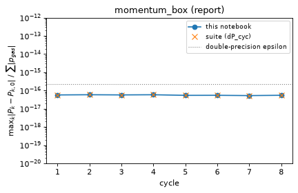

   Linear-momentum drift max_k \|P_k - P_k,0\| / Σ\|p_gas\| per cycle in a periodic 3-D box (gas + radiation face momenta). A report, no criterion; here at round-off.

Positivity
~~~~~~~~~~

- **Density** stays above its floor by construction
  (``dfloor_flux_limit``, above).
- **Radiation energy :math:`E`** is non-negative by construction of the implicit operator: it is an
  M-matrix for any Eddington tensor and step (the kinetic share has :math:`h^+\ge0\ge h^-`, the
  advective flux takes the smallest donor share that keeps the M-matrix, the off-diagonal
  stress enters in donor-cell form). Zalesak limiters on the explicit stage increment and on
  the written-back fluxes keep :math:`E` above ``e_floor``; they scale only the energy flux, so
  momentum is untouched. A floor remains behind them; it takes its energy from the cell's gas
  or its column and is counted. The cone limit keeps :math:`|\mathbf F|\le cE`.
- **Gas internal energy** is not positive by construction. A step that would make it
  negative is rejected and repeated (backward Euler, then a smaller dt), or the missing energy
  is taken from the radiation of the same cell (``implicit_pos_gas``, energy-conserving).

All such events are counted in the end-of-run ``vet-positivity`` line. Test: every suite deck
runs with no floor raise, no energy created and no ``CLEAN WARNING`` (``floor_pay`` raises the gas
temperature on purpose, and pays it from the radiation); ``diffusion`` (a top-hat in E at
tau_cell = 1e4 stays within [background, background + amplitude] to round-off) and ``marshak``
(a Marshak wave into a cold slab: E and T_gas positive and below the bath values).

Well-balance: equilibrium envelopes stay at rest
~~~~~~~~~~~~~~~~~~~~~~~~~~~~~~~~~~~~~~~~~~~~~~~~

A star in hydrostatic and radiative equilibrium is designed as a steady state of the discrete
equations. The gas sees only the deviation of the radiative force from a reference force that
balances gravity (``force_reference = wb_arad``, held by the well-balanced hydro), and the face
flux rows are written about the rays' own steady state (``clean_stag_fwb``). The steady start
(``clean_init = steady``) begins from the scheme's own discrete equilibrium. The remaining
motion is at the solver-tolerance level, not round-off.

A rotating ray set is a new angular discretisation at every turn, so its closure of the same
static state differs by the set's pattern error (~1e-4 in F) and a static envelope has no
discrete equilibrium to keep (v/c_s ~1e-4 - 1e-3). With ``vet_rotate_avg_ema_wb = true`` the
EMA ring takes up the pattern change of a turn in its offsets (the boundary's same-state
Delta, weight a = a_ch alone, a_ch the change test of one set at two times): a set change
then moves the closure only where the state moved, so a static state keeps its closure, its
force and its equilibrium for any turn and cross-fade weight. On the cubed sphere the ring
also carries the cells' face half ranges (``CleanCellHalf``). The K-set
window (``vet_rotate_avg`` without the EMA) has no such form: its window changes the closure of
a static state at every turn.

Test: ``wb_sp``, ``wb_cs`` (max \|v|/c_s <= 1e-8 over the run; measured about 5e-9 and 1e-9; with
the rotating sets ``_rot`` 4.7e-9 and 9e-10).

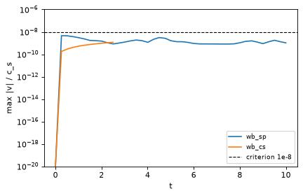

   Largest \|v\|/c_s of an envelope in hydrostatic and radiative equilibrium against time (spherical polar to t = 10, cubed sphere to t = 2.5). Pass: below 1e-8 (dashed).

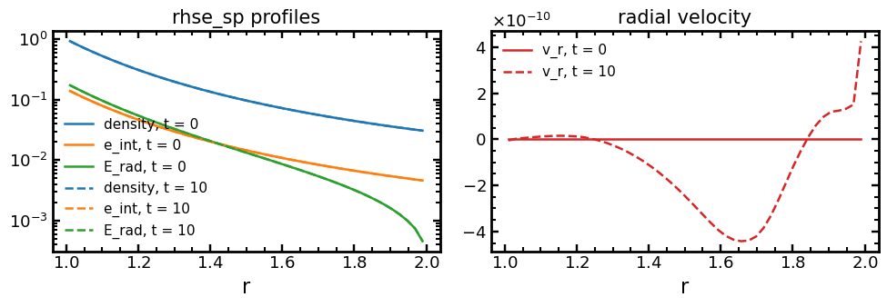

   The spherical-polar envelope at t = 0 and t = 10: density, internal and radiation energy (left; the curves overlap) and the radial velocity, of order 1e-10 (right).

Order of accuracy in space and time
~~~~~~~~~~~~~~~~~~~~~~~~~~~~~~~~~~~

The face terms are second order in space by design. What the tests measure:

- Time, deck D (spherical shell, kinematic gas, dt halved from 1/16 to 1/256 on a fixed
  grid): the successive orders are 1.57, 1.61, 1.84 (E), 1.50, 1.52, 1.81 (F_r) and 1.34,
  1.43, 1.83 (T), below 2 on the whole ladder. The finest pair differs by 3.15e-5 (E),
  1.68e-4 (F_r) and 6.9e-6 (T). The loss is attributed to the weight 1/(1 + z), z = c dt/dx,
  of the stage-2 closure line (an earlier study, not re-measured on this release).
- Grid and time step together, a linear radiation-hydro wave (N = 16 ... 128): the orders are
  1.79, 2.19 (E) and 1.50, 1.94 (v); the finest pair differs by 4.49e-3 (E) and 1.11e-2 (v).

The exchange is not stiff in either deck. Where it is stiff, the production tableau
(``time2_tableau = sdirk2``) is first order in time: on a radiation-acoustic wave (64 cells,
dt halved) the successive orders of E are 1.08, 1.04 at x = 100 and fall 1.51, 1.34, 1.20 at
x = 1 and at x = 10 (``time2_tableau = hesdirk2``: 2.0 in all three). These are from a study on
this release, not a suite test.

Test: ``order_time`` (order of the finest pair >= 1.7), ``order_space`` (linear
radiation-hydro wave on a Cartesian mesh, finest pair >= 1.7).

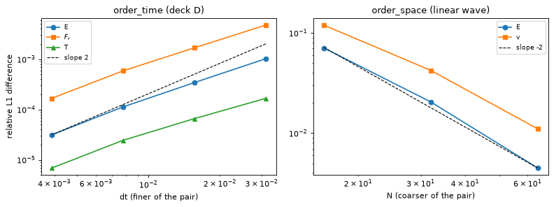

   Relative L1 difference of successive levels against dt (left, deck D) and against N (right, linear wave), with a slope-2 line. Pass: order of the finest pair >= 1.7.

Radiation-acoustic waves in every trapping regime
~~~~~~~~~~~~~~~~~~~~~~~~~~~~~~~~~~~~~~~~~~~~~~~~~

A small sound wave in gas + radiation is damped by the radiation and, where the radiation is
trapped, travels at the mixture sound speed. The scheme reproduces the analytic root of the
linear gas + moment system (with its own closure and exchange) from the free-streaming
(:math:`x = 0.01`) through the intermediate (:math:`x = 0.1`, 1) to the trapped limit (:math:`x = 100`), at
cfl 0.3 and the larger dt that ``rad_signal_speed_diff`` gives in thin gas (2.8 x at :math:`x = 0.01`).

Test: ``radwave`` (phase speed within 3e-3, damping within 5e-3 per radian, no growth).

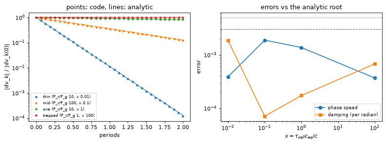

   Left: decay of radiation-acoustic waves from the free-streaming (x = 0.01) to the trapped limit (x = 100); points code, lines the analytic root. Right: phase-speed and damping errors against x. Pass: phase speed within 3e-3 (dashed), damping within 5e-3 per radian (dotted).

Closure accuracy: beams, shadows, emitting bodies, non-LTE atmospheres
~~~~~~~~~~~~~~~~~~~~~~~~~~~~~~~~~~~~~~~~~~~~~~~~~~~~~~~~~~~~~~~~~~~~~~

The Eddington tensor and the thin-limit face fluxes come from the rays, so radiation that is
far from isotropic keeps its direction: crossing beams pass through each other, a beam
behind an opaque cloud leaves a sharp shadow, and the field around an emitting cylinder
follows exact transport (an M1 closure merges crossing beams and fills shadows). Each beam
of the test, 4 cells wide, stays straight at its angle but carries 1.20 x the exact energy
(1.79, 1.39, 1.20, 1.09 x at 1, 2, 4, 8 cells; the cap of the streaming share at its edges),
while its energy flux equals the injected flux to 6e-8. Around
the cylinder E and the energy flux Phi are within 1.1 % and 1.2 % of exact transport; the face
momentum F there is about 20 % above it (an earlier study with other keys attributed this to
the harmonic face opacity at the sharp edge; not re-measured here).

Test: ``idort_beams`` (L1 of E and the beam energy within 5 % of 0.2015 and 1.204), ``idort_shadow``, ``idort_shadow_gl`` (L1
0.014 and 0.013), ``idort_cylinder`` (E and Phi outside 0.011 and 0.012), ``nlte_eps1e-1``, ``nlte_eps1e-4`` (J
against exact transport, L1 1e-4 and 1.3e-3); ``idort_beams_mb`` (4 MeshBlocks: identical in
tile mode); ``shadow`` (a clump lit by an isotropic bath: 0.6 % of the unshadowed radiation is
left in the geometric umbra behind it, bound 2 %; regions whose sight lines miss the clump
unchanged to 2 %).

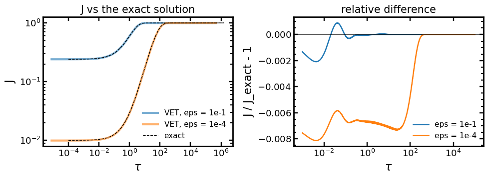

   Mean intensity J against optical depth in a two-level-atom atmosphere (epsilon = 0.1 and 1e-4) with the exact transport solution (left) and the relative difference (right). Pass: L1 within 5 % of the reference value.

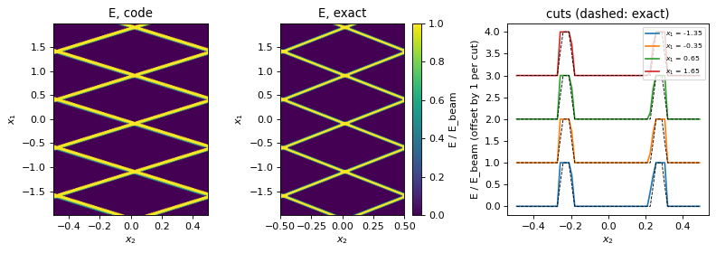

   Two 4-cell-wide beams crossing in vacuum at ±45 deg: E of the run and the exact straight beams (images) and cuts across the beams at four heights (dashed: exact). The beams stay straight and carry 1.20 x the exact energy, at the exact energy flux. Pass: L1 of E and the beam energy within 5 % of 0.2015 and 1.204; energy flux through every row within 1e-5 of the injected.

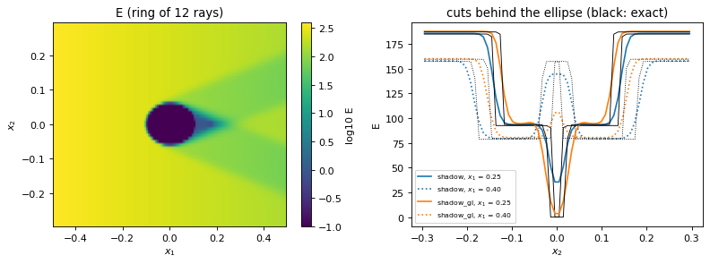

   Two beams past an opaque ellipse: log E of the ring run (left) and cuts behind the ellipse for the ring and the general 8 x 32 ray set against the exact attenuated beams (right). Pass: L1 within 5 % of 0.0138 and 0.0126.

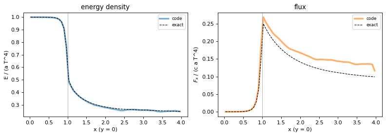

   Homogeneous emitting cylinder (r < 1): E, the energy flux Phi_x/c and the face momentum F_x/c along y = 0 against exact transport. Pass: L1 of E inside, E outside, Phi outside and F outside within 5 % of 5.3e-4, 0.011, 0.0116, 0.203.

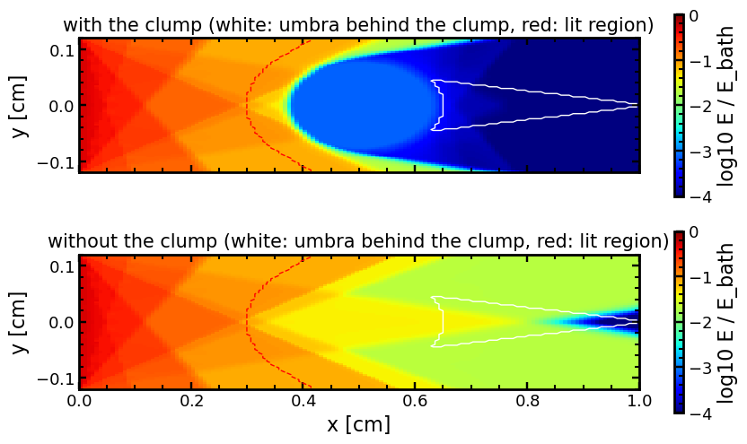

   log10 E / E_bath with (top) and without (bottom) an opaque clump lit from the left by a 1740 K bath; white: the geometric umbra behind the clump, red dashed: the region whose sight lines miss the clump. Pass: <= 2 % of the radiation left in the umbra (measured 0.6 %), the lit region unchanged to 2 %.

Radiation hydrodynamics: radiative shocks and stiff exchange
~~~~~~~~~~~~~~~~~~~~~~~~~~~~~~~~~~~~~~~~~~~~~~~~~~~~~~~~~~~~

The coupled scheme holds the Lowrie & Edwards (2008) non-equilibrium radiative shocks at their
semi-analytic profiles, precursor, Zel'dovich spike and relaxation region included, without
a shift of the shock (with ``clean_closure = eddington``, as the reference is grey
non-equilibrium diffusion). The gas-radiation exchange is L-stable: at time steps of up to 1e5
relaxation times the gas reaches the exact equilibrium temperature with the total energy
conserved.

Test: ``idort_radshock_m2``, ``idort_radshock_m5`` (L1 of rho, v, T_gas, T_rad 2.5e-4 to 2.2e-3,
each within 5 % of the reference), ``idort_thermal_eq2`` (error of T within 5 % of 2e-3 after
5 steps, energy drift <= 1e-13), ``thermal_eq``; ``radshock``, ``radshock_m5`` (the same shocks
with the production closure: L1 of rho and T_rad about 0.5 % and 1 %, within 5 % of the
reference values; the difference from the Eddington run is the closure in the thin
precursor).

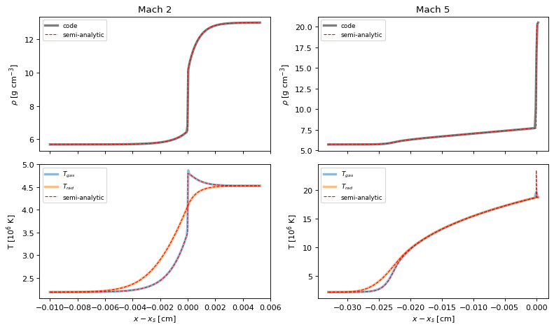

   Lowrie & Edwards radiative shocks at Mach 2 and 5: density and gas and radiation temperatures against the semi-analytic profiles (dashed), no shift. Pass: L1 of rho, v, T_gas, T_rad each within 5 % of the reference.

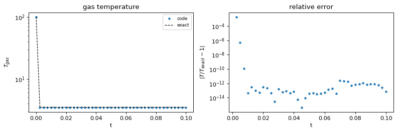

   Hot gas cooling into radiation at dt = 5 to 1e5 relaxation times: T(t) against the exact ODE and the relative error. Pass: error within 5 % of 2.0e-3, energy drift below 1e-13.

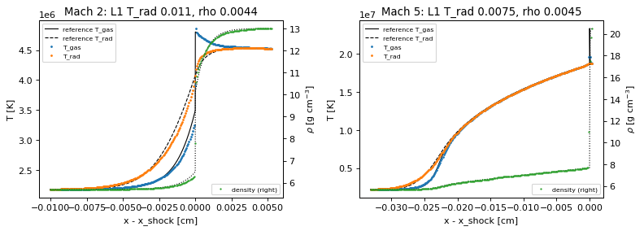

   Lowrie & Edwards radiative shocks at Mach 2 (left, subcritical) and Mach 5 (right, supercritical) after 2e-10 s on 256 cells: gas and radiation temperature and density (points) against the semi-analytic profile (lines). Pass: L1 of rho and T_rad within 5 % of the reference values (about 0.5 % and 1 %), every L1 below 1-2 %, no ``CLEAN WARNING``.

Diffusion limit: asymptotic preserving
~~~~~~~~~~~~~~~~~~~~~~~~~~~~~~~~~~~~~~

In an optically thick medium the moment equations must reduce to diffusion with
D = c/(3 rho kappa) however thick a single cell is; a scheme without this property is too
diffusive by a factor ~tau_cell. In the thick limit the staggered face flux is the compact
diffusion flux :math:`-(c/\chi_f)\,\partial_n(\mathsf D E)` with no added dissipation, so the
diffusion coefficient is right at every tau_cell.

Test: ``diffusion`` (a Gaussian pulse: variance growth within 2e-3 of 2 D t at tau_cell = 10,
1e3, 1e5 and 1e-4 in 2-D; measured 8e-4, 8e-8, 1e-10, 9e-7).

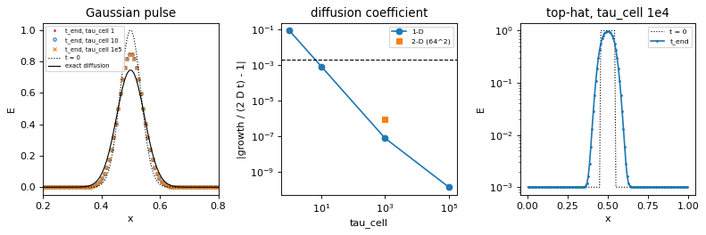

   Left: a Gaussian pulse diffusing in a static scatterer at tau_cell = 1, 10 and 1e5 against the exact diffusion solution. Middle: error of the diffusion coefficient against tau_cell (1-D and 2-D). Right: a top-hat at tau_cell = 1e4. Pass: \|growth/(2 D t) - 1\| <= 2e-3 at tau_cell >= 10 (dashed), the top-hat within its initial bounds.

Moving media
~~~~~~~~~~~~

The equations are mixed frame with the :math:`O(v/c)` and dynamic-diffusion :math:`O(\beta^2)` terms,
and the face flux includes the advective flux of radiation carried by the gas, so radiation
trapped in a moving gas moves with it and a uniform medium at the coupling's fixed point
stays there.

Test: ``advect_pulse`` (a diffusing pulse advected at v against the same pulse at rest shifted by
v t: L1 <= 3e-3, measured 7e-4), ``advect_uniform`` (a uniform medium at 0.01 c: T changes by
<= 1e-5, measured 1.4e-6).

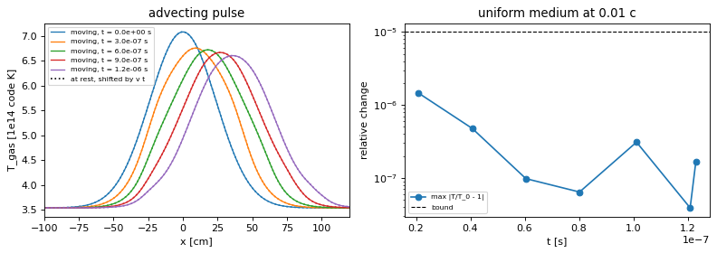

   Left: a diffusing radiation pulse advected at 3e7 cm/s (solid) against the same pulse at rest shifted by v t (dotted). Right: the largest change of T in a uniform medium moving at 0.01 c. Pass: L1 <= 3e-3; change <= 1e-5 (dashed).

Phi mirror symmetry on narrow wedges
~~~~~~~~~~~~~~~~~~~~~~~~~~~~~~~~~~~~

The ray set must map onto itself under the phi-wall mirrors of the wedge and, at a theta
seam, under the equatorial mirror. On a phi-periodic spherical-polar wedge the rays' phi-wall
maps are therefore exact only when the wedge width is a whole number of the direction set's
azimuthal periods (Gauss-Legendre
:math:`n_\theta\times n_\phi`: 360 deg\ :math:`/n_\phi`; LQ10: 90 deg; the default icosahedral set: 180 deg);
any other width stops the run with a FATAL error. A narrow wedge that cannot meet this
(e.g. 0.064 rad) names ``vet_gd_wall_sym = true`` with ``vet_gd_wall_interp = true``: the set is
turned to have a mirror plane on the wedge centre, the two walls' maps are mirror images, and
the seam face is computed in both frames. A mirror-symmetric state then has a wedge-mean
:math:`F_\phi` of zero to round-off. On a theta-periodic wedge the theta seam face is likewise computed
from both sides, its other side being the exact equatorial mirror of this side
(``vet_gd_theta_seam_sym = true``, required on theta-periodic meshes: FATAL otherwise), which
removes the one-frame seam face's net :math:`F_\theta` (the 2.5e-2 mirror error of the 20-deg deck).

Test: ``wedge_sym`` (a spherically symmetric shell on 3.7 and 7.3 deg wedges with the key and a
20 deg wedge without it: :math:`|\sum F_\phi|/\sum|F_r| \le 10^{-8}`, measured 2e-12 to 2e-9; the
narrow wedge without the key stops with the FATAL; the shell made theta-periodic stops with
the FATAL without ``vet_gd_theta_seam_sym``; with it the mean :math:`F_\theta` is <= 1e-8 of
:math:`\sum|F_r|` after 8 cycles, measured 1.6e-14).

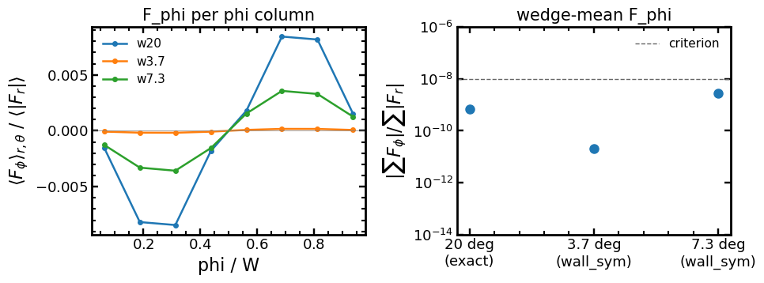

   Left: F_phi per phi column on the 20, 3.7 and 7.3 deg wedges. Right: the wedge-mean \|ΣF_phi\| / Σ\|F_r\| of each wedge. Pass: below 1e-8 (dashed); the 3.7 deg wedge without ``vet_gd_wall_sym`` stops with the wedge FATAL.

Restart and dt retry: bitwise
~~~~~~~~~~~~~~~~~~~~~~~~~~~~~

The restart file carries the full scheme state (stage slope, face momenta, closure history,
ray cut, ledger), so N steps straight and N/2 steps, a restart and N/2 more are identical.
A dt retry restores a full cycle checkpoint, so a retry at the same dt repeats the step
exactly. The restart file also records every key, and a restart uses the recorded value
(see the restart rule in :doc:`keys`).

Test: ``restart_sp``, ``restart_cs``, ``dt_retry`` (difference 0).

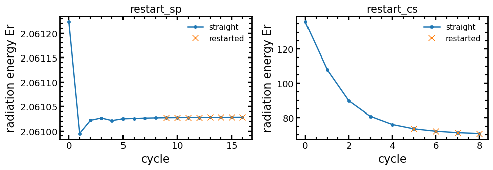

   Radiation energy per cycle of the straight run (dots) and of the run restarted half-way (crosses). Pass: every dump and history row identical (difference 0).

Reproducibility
~~~~~~~~~~~~~~~

- **Same binary, same layout:** bitwise from run to run.
- **MPI rank count:** bitwise. With ``<mesh>/layout_invariant = true`` (default) every global
  or shell sum goes through an exact binned accumulator, so it does not depend on the order
  of its terms. Not part of the suite.
- **MeshBlock layout, tile mode** (``layout_invariant_mode = tile``, ``layout_tile = N``): the
  sums and the multigrid act on fixed N x N lateral tiles. Layouts made of whole tiles are
  bitwise identical when there is one MeshBlock along x1 and, if the theta boundaries are ray
  walls (mirror or vacuum), one MeshBlock along x2, as in the production templates. Splitting
  across such walls gives a round-off difference (below 1e-13 of the largest
  value after 8 cycles, CPU, 89b05b1c7).
- **Block mode** (default): the result depends on the MeshBlock size at the solver
  tolerance, because the preconditioner is MeshBlock-local.

Test: ``layout_tile`` (1 x 2 MeshBlocks along phi vs one MeshBlock: identical; 2 x 2, which
also splits theta across the ray walls: bounded at 1e-8).

CPU / GPU consistency: round-off, not bitwise
~~~~~~~~~~~~~~~~~~~~~~~~~~~~~~~~~~~~~~~~~~~~~

One Kokkos implementation runs on CPUs and on NVIDIA and AMD GPUs. The sums are
backend-independent (exact accumulators), and ``-ffp-contract=off`` (with ``--fmad=false`` for
CUDA device code) removes fused multiply-add differences. The math libraries (exp, pow, the
EOS) differ between backends, so CPU and GPU agree to round-off on smooth problems and far
below the time-step error on stiff ones, but not bit for bit. See :doc:`build` for a
toolchain that does not agree.

Test: the suite on a GPU binary (:doc:`tests`, "GPU builds").

No silent fallbacks
~~~~~~~~~~~~~~~~~~~

The scheme never changes method silently. Every backward-Euler redo, dt retry, solver switch
or unconverged acceptance prints a ``CLEAN`` or ``DT_RETRY`` line, an exhausted retry is FATAL,
and an unsupported combination of keys (mesh refinement, :math:`\hat c<c`, removed keys or values,
missing prerequisites) stops the run with a FATAL error naming the key. Some counted
corrections (paid floor raises, limiter remnants, the automatic backward-Euler back-off of
``time2_auto_be``) are reported only in the end-of-run summary; the floor-gas cap prints every
``floorcap_report`` cycles. See :doc:`outputs`.

Cartesian, spherical-polar and cubed-sphere meshes, one implementation
~~~~~~~~~~~~~~~~~~~~~~~~~~~~~~~~~~~~~~~~~~~~~~~~~~~~~~~~~~~~~~~~~~~~~~

The face and cell kernels are written once in terms of cell volumes, face areas,
centre-to-centre distances and each cell's local orthonormal frame, which each mesh supplies
(the exact AthenaK volumes and areas on curved meshes). Supported: Cartesian 1-D to 3-D,
spherical polar 1-D to 3-D (wedges, axisymmetric, full sphere (not tested, below); radial
stretching allowed) and the cubed sphere. The mesh must not be refined (FATAL). Two
options are geometry-specific by construction: ``clean_stag_fwb_ring`` (3-D spherical polar with
periodic phi) and the cubed-sphere torque redistribution.

Tests: the ``*_sp`` and ``*_cs`` variants above; ``order_space`` on a Cartesian mesh.

In the code but not tested
~~~~~~~~~~~~~~~~~~~~~~~~~~

No deck in ``tests/vet_clean`` or ``inputs/rad_vet_clean`` and no test of the suite covers the
following. The properties of this section are not verified there.

+-------------------------------------+------------------------------+------------------------------+
| feature                             | state                        | what is tested instead       |
+=====================================+==============================+==============================+
| spherical polar with the poles      | accepted, not tested         | wedges clear of the poles;   |
| (full sphere,                       |                              | the full sphere on the cubed |
| ``<mesh>/use_polar_boundary``)      |                              | sphere (``*_cs``)            |
| under ``vet_gd``                    |                              |                              |
+-------------------------------------+------------------------------+------------------------------+
| stretched theta                     | accepted, not tested         | uniform theta; radial        |
| (``<mesh>/use_grid_stretch_theta``, |                              | stretching in the star decks |
| ``theta_plateau``) under ``vet_gd`` |                              |                              |
+-------------------------------------+------------------------------+------------------------------+
| several MeshBlocks along x1 under   | the sweep has the code, but  | one MeshBlock along x1;      |
| ``vet_gd``                          | the start-up check stops     | several on a Cartesian mesh  |
|                                     | with a FATAL error on        | with ``closure = vet_sc``    |
|                                     | spherical polar and the      | (``idort_beams_mb``)         |
|                                     | cubed sphere                 |                              |
|                                     | (``meshblock/nx1`` must      |                              |
|                                     | equal ``mesh/nx1``), so it   |                              |
|                                     | cannot be reached            |                              |
+-------------------------------------+------------------------------+------------------------------+
| radiation with MHD (``<mhd>`` in    | accepted with                | hydrodynamics only           |
| place of ``<hydro>``;               | ``time2_tableau = hesdirk2`` |                              |
| ``RadiationVet::EmagBuild`` takes   | (default) or ``trbdf2``, not |                              |
| \|B|^2/2 out of the gas energy)     | tested; ``sdirk2``, the      |                              |
|                                     | tableau of the star decks,   |                              |
|                                     | is FATAL with MHD and matter |                              |
|                                     | coupling; ``<hydro>`` and    |                              |
|                                     | ``<mhd>`` together are FATAL |                              |
+-------------------------------------+------------------------------+------------------------------+
