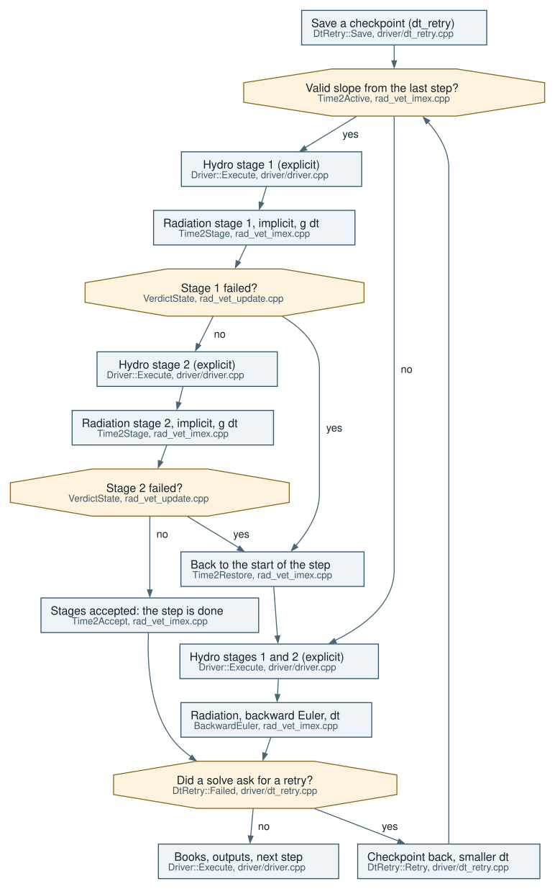

.. This page is generated by tools/sync_from_code.py from docs/vet_clean/SCHEME.md of the code
   repository. Edit the Markdown there and re-run the script.

The VET scheme
==============

This page describes the default grey radiation scheme for implicit transport (keys:
:doc:`Keys <keys>`). It stays at the level of the method and its properties. The tests named below
are those of the test suite (see :doc:`Tests <tests>` for the decks and the
exact criteria).

The method in brief
-------------------

One time step: the hydrodynamics is explicit, the radiation and its exchange with the gas are implicit in two
stages. A step whose stage fails is done again with one implicit solve, and a step that still fails is taken
again at a smaller size. The step is drawn under Code map (section 3).

Features
~~~~~~~~

- **Second order in time and space.** Measured orders of the finest pair: 1.8 in time, 1.9-2.3
  for cells and time step refined together, and 2 also where the gas-radiation exchange is stiff
  (tests ``order_time``, ``order_space``, ``order_stiff``; :doc:`properties`;
  worked examples in :doc:`Notebooks <gallery>`). The implicit discrete-ordinates
  radiation of Athena++ (Jiang 2021) is, as that paper states, first order in time.
  What the order means: the error falls as a power of the cell size. With second order, 10 times
  finer cells make the error 100 times smaller; with first order only 10 times smaller. Put the
  other way: to make the error 10 times smaller, a second-order method needs cells about 3 times
  finer, a first-order one 10 times finer. In 3-D the cost grows as the fourth power of the
  resolution (three directions, and a time step that shrinks with the cell), so that is about 100
  times the cost against 10,000 times. The same holds for the time step: a code whose radiation is
  first order in time (backward Euler) needs much smaller steps for the same accuracy, or accepts a
  larger error at the same cost.
- **Many angles.** The Eddington tensor comes from rays along a fixed set of directions, 126 in
  the star templates (Gauss-Legendre 7 x 18). Crossing beams pass through each other, and a clump
  leaves a sharp shadow (0.6 % of the radiation left in its umbra); an M1 closure merges the
  beams and fills the shadow (tests ``idort_beams``, ``shadow``).
- **Speed.** 57 d of a blue supergiant (16.8 million cells) in 6.0 h on one node of 4 H200;
  48-84 times faster in wall time than the Athena++ CPU runs of the same three stars, which
  differ in hardware, angles and cells (:doc:`performance page <performance>`). A step normally
  costs one ray sweep; the implicit solve takes 53-73 % of a cycle, the rays 15-38 %. Maps and
  movies of the runs: :doc:`Gallery <star_runs>`.
- **Iterations per step.** A step has two implicit stages. In the four star runs a stage takes
  2.2-4.1 Newton passes on average (mostly 2 to 5), each one linear solve of 5.5-7.4 BiCGStab
  iterations on average, so 15-24 iterations per stage, plus one ray sweep per step. No step had
  to be retried or redone (0 of 380,141 steps; from the solver's per-stage log lines).
- **Conservation and positivity.** Gas + radiation energy and mass are conserved to round-off,
  :math:`L_z` exactly on the cubed sphere; linear momentum is not conserved in general. Second order
  with local first-order fallbacks where positivity needs them, all counted (Positivity, below;
  :doc:`properties`).

**Equations.** Two-moment grey radiation transport for the radiation energy
density :math:`E` and flux :math:`\mathbf F`, in the mixed frame: lab-frame moments with
comoving-frame opacities, keeping the :math:`O(v/c)` terms and the :math:`O(\beta^2)` terms that are
leading order in dynamic diffusion (Krumholz et al. 2007; the β terms follow Ma et al. 2025,
eqs. 56-57):

.. math::

   \partial_t E + \nabla\!\cdot\mathbf F = -c\,G^0,\qquad
   \partial_t \mathbf F + c^2\,\nabla\!\cdot(\mathsf D\,E) = -c^2\,\mathbf G ,

where :math:`G^0` and :math:`\mathbf G` are the energy and momentum exchange with the gas
(absorption, emission, scattering). The gas receives exactly the opposite:
:math:`\partial_t(\rho e_{\rm tot}) \mathrel{+}= c\,G^0`, :math:`\partial_t(\rho\mathbf v) \mathrel{+}= \mathbf G`.
The gas EOS is gas-only (any AthenaK EOS, including tabulated ones); radiation pressure acts on
the gas only through :math:`\mathbf G`. The scheme requires the full speed of light, :math:`\hat c = c`.

**Closure: variable Eddington tensor from rays.** :math:`\mathsf D = \mathsf K/J` comes from a
formal solution of the grey transfer equation :math:`\hat n\cdot\nabla I = \chi(S - I)` along a
fixed set of directions. One short-characteristics method (sc) serves every mesh: the same
formal solution along each ray segment (the source linear in optical depth, upwind values
interpolated from the neighbouring cells) and the same boundary rules. Only the order of the
sweep and the direction set follow the mesh: shell by shell on spherical-polar and
cubed-sphere meshes, with a global set (a Gauss-Legendre product set, level-symmetric,
geodesic or HEALPix set), and layer by layer along x1 on Cartesian meshes, with a double-Gauss set about x1, a ring, or the same global set. The source
function is the state's own (:math:`\epsilon\,aT^4 + (1-\epsilon)E`, or an absorption/scattering
split), so the closure does not depend on :math:`\Delta t`. Besides :math:`\mathsf D`, the rays give the
half-range fluxes (outgoing and incoming parts of the flux) and the rays' own flux through
each face, which the face fluxes use in optically thin regions. Normally a step costs one ray
sweep: the second stage uses an extrapolation of the closure in time.

**Where the rays start.** The rays are not swept through the whole star. On 3-D
spherical-polar and cubed-sphere meshes with one MeshBlock along the radius (the star runs),
the sweep starts at a shell chosen automatically, the ray cut: in each column, the lowest cell
that is thinner than one optical depth or where the source function changes by 1 % or more per
optical depth, then 10 optical depths deeper; the deepest cut of all columns is used. The cut
moves down at once and up only after 10 ray builds, and restart files keep it. Below the cut
the closure is the diffusion limit of each cell's own :math:`E` and :math:`\mathbf F` (the intensity
:math:`J + 3\,\hat n\cdot\mathbf H` in every direction), whose error there is at most of the order of the
square of that 1 %. Outward rays start at the bottom of the swept shells with the diffusion
intensity :math:`S + \mu\,(-dS/d\tau)`; inward rays start at the top with no incoming radiation (or
a bath or a mirror where the boundary asks for one). On a periodic wedge, a ray that leaves
through one side comes back through the other side in the matching direction of the set.
Each build sweeps every direction once: inward rays top-down, then outward rays bottom-up,
one shell at a time. The cut is one shell index for the whole mesh, found from whole radial
columns, so it needs the radius in one MeshBlock, as in the star runs; Cartesian meshes have no
cut and sweep all cells, layer by layer along x1. The settings are on
:doc:`Keys <keys>`.

**Scattering without a scattering iteration.** Electron scattering enters twice. In the moment
equations it is part of the total extinction in the flux equation and, in the energy equation,
of the O(v/c) work of the radiation force on the gas (with the flux-mean opacity) and the
:math:`O(\beta^2)` terms; it exchanges no heat (grey, coherent and isotropic in the comoving frame). All
of this is linear in :math:`E` and :math:`\mathbf F` and solved implicitly with the rest, so the moments carry
the scattering exactly. In the rays' source function the scattering part needs the mean intensity :math:`J`
(``vet_scatter``, ``vet_scatter_form``; absorption and scattering split as in Ma et al. 2026). :math:`J` is not iterated from the rays (a lambda iteration, which converges
very slowly where scattering dominates): it is taken from the moment solution, :math:`J = E` at the end
of the stage (``vet_scatter_j = relaxed``). The rays then give only the shape of the field, :math:`\mathsf
D = \mathsf K/J`, which depends weakly on :math:`S`; the moment system does the work of the iteration,
as in a variable-Eddington-tensor or synthetic-acceleration method. The steady start
repeats rays and moments to convergence; in a run the closure is updated
once per step.

**Rotating rays.** A fixed set of directions leaves ray effects: light from a hot spot or a
compact source travels only along the directions of the set, and the closure carries that
pattern. On the cubed sphere the set is rotated every ``vet_gd_rotate_dt`` of physical time
(``auto`` = 20 times the first time step), and the closure is an exponential moving average over
the rotated sets (``vet_rotate_avg_ema``, 128), so the pattern averages out instead of being frozen
into the solution. With ``vet_rotate_avg_ema_wb = true`` a static envelope keeps its closure and its
equilibrium across a turn (section 2, well balance). Spherical-polar wedges use a fixed set
(``vet_gd_rotate_dt = 0``, the default there); the RSG and HG runs rotate.

**Staggered layout.** :math:`E` lives at cell centres; the radiation flux lives on the cell faces,
one normal component per face. The face flux of a stage is a blend of

- a compact diffusion / wave flux, :math:`-(c/\chi_f)\,\partial_n(\mathsf D E)` in the optically
  thick limit and the staggered wave operator in the thin limit (no added dissipation needed);
- a kinetic (upwind discrete-ordinates) flux from the rays' half ranges, which takes over where
  the field is anisotropic;
- the advective flux :math:`\mathbf a E` of radiation carried by the gas, and lagged terms (the
  off-diagonal stress and a consistency correction towards the rays' own thin-limit flux).

**Time integration.** The scheme is second-order accurate in time. The hydrodynamics is
AthenaK's explicit two-stage integrator (``rk2``); the radiation and the gas-radiation exchange
are implicit, with a two-stage implicit Runge-Kutta method (``time2_tableau = sdirk2``). The two
parts are coupled so that the whole step stays second order, also where the gas-radiation
exchange is stiff.

**Implicit stage solve.** In each stage the face momentum equation is eliminated face by face,
which leaves a scalar system for :math:`E`. It is solved by Newton passes: each pass is a
right-preconditioned BiCGStab with a line-relaxation multigrid preconditioner, followed by an
exact per-cell root for the gas temperature (any EOS; in the stage-2 solves
the secant chord replaces the tangent only where it is better by more than a derived round-off
bound, 16 eps of the terms of :math:`e(T) - e(T_p)`), then a line solve that recovers the face
fluxes. Convergence is measured in each cell's own energy budget of the stage, with the
tolerance tied to the step's time-error estimate.

**Positivity.** No linear scheme above first order keeps a solution positive for every step
(Godunov 1959). The scheme is therefore second order where nothing is near zero and falls back
to a first-order positive form only locally, where it is needed; every such event is counted
(the end-of-run ``vet-positivity`` line, the FOFC and backward-Euler counts). From first to last:

- hydrodynamics: first-order flux correction (``hydro/fofc``, ``fofc_retest``;
  ``hydro/hydro_fofc.cpp``): a trial update flags every cell where a floor or the velocity
  ceiling would act, and the faces of that cell take the first-order LLF flux.
  ``dfloor_flux_limit`` scales back the outflow of a nearly empty cell so that its density
  stays above the floor;
- radiation energy :math:`E`: the implicit operator is an M-matrix for any step (donor-cell and
  smallest-donor parts), and Zalesak limiters on the explicit stage increment and on the
  written-back fluxes keep :math:`E` above ``e_floor``;
- time: a failed implicit stage is redone with backward Euler (first order, L-stable), and a
  step that still fails is taken again with a smaller dt (``time/dt_retry``);
- last: floors, which take their energy from the cell's gas or radiation (``implicit_pos_floor``,
  the gas positivity rule, ``hydro/floor_pay = rad_column``) and are counted.

In the four finished star runs no stage fell back and no step was redone or retried; the only
backward-Euler step of each run was the first step of its fresh start. Every suite deck runs
with no floor raise, no energy created and no solver warning (except ``floor_pay``, which raises
the gas temperature on purpose and pays it from the radiation).

**Well-balanced formulation.** For a hydrostatic envelope in radiative equilibrium, the
problem generator supplies the reference radiative acceleration of the initial state; the
well-balanced hydro already holds it, and the radiation hands the gas only the residual
force. The face flux equations are written as deviations from the rays' own steady state,
and a steady start relaxes the initial radiation to the scheme's own
discrete steady solution in the given gas.

Code map
--------

|One time step|

:doc:`code_layout`: flow charts of a step, a stage, the closure and the linear solve, and the list of files.
Start in ``src/rad_vet/rad_vet_tasks.cpp``. Outside ``src/rad_vet``: ``driver/driver.cpp`` (the step), ``driver/dt_retry.cpp``
(checkpoint), ``utils/imex_sdirk2.hpp`` (tableaux), ``utils/repro_sum.hpp`` (layout-invariant sums),
``bvals/physics/rad_vet_bcs.cpp``.

