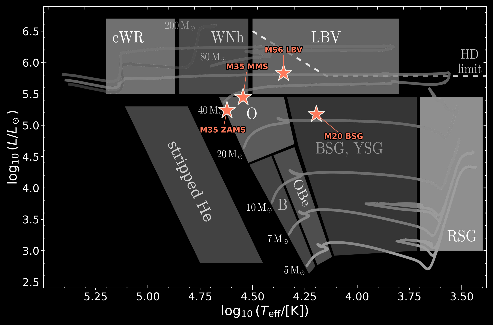
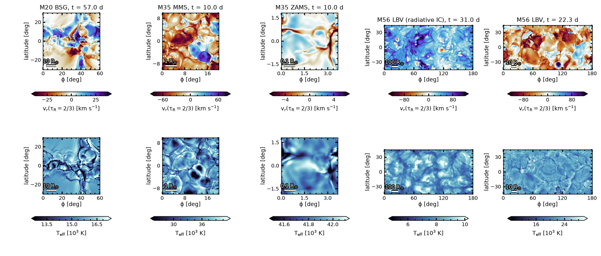
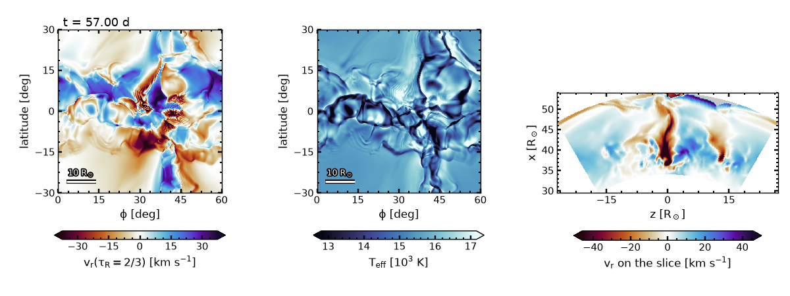
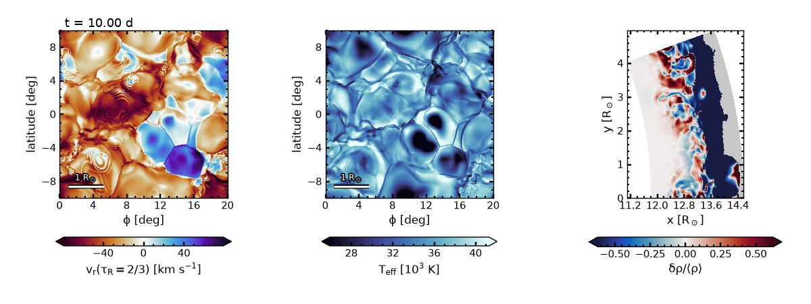
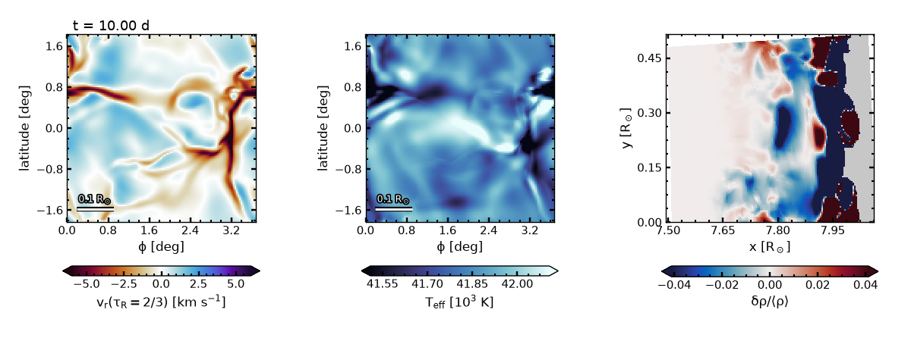
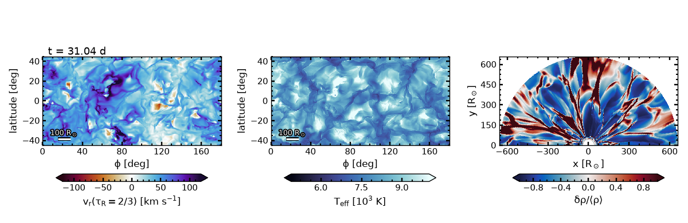
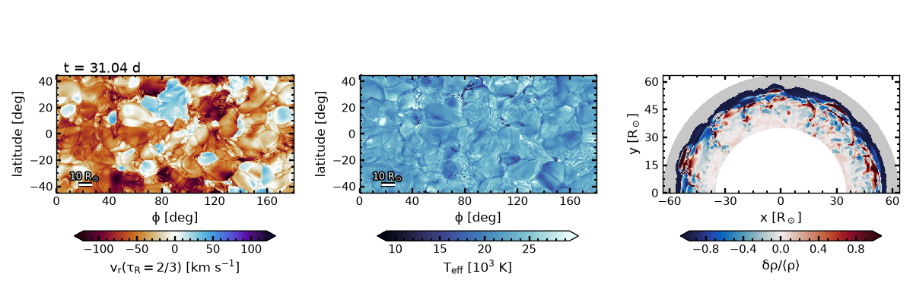

Gallery
=======

2-D maps and movies of five 3-D runs of massive stars, each on one node of 4 H200 GPUs. The wall times, the
comparison with CPU runs and the cost of each module are on :doc:`performance`. How to set up a star run:
:doc:`stars`.

Each figure of one star shows three maps:

- left: the radial velocity :math:`v_r` in km/s at the photosphere of each column, Rosseland optical depth
  :math:`\tau_R = 2/3` (the same for all five stars; linear between cell centres, no smoothing);
- middle: the effective temperature :math:`T_{\rm eff}` in :math:`10^3` K of each column, from the comoving flux
  at its :math:`\tau_R = 2/3` (also the same for all five stars);
- right: the density relative to the mean of its shell, :math:`\delta\rho/\langle\rho\rangle`, on a slice in radius
  and angle. Grey is gas near the density floor (at most 1.5 times the floor).

Axes are in solar radii and degrees. :math:`R_{\rm ph,IC}` is the photosphere radius of the initial model. The scale
bar on the maps is a length at the median photosphere radius of the dump shown, exact at the equator: 10
:math:`R_\odot` for M20 BSG, 1 for M35 MMS, 0.1 for M35 ZAMS, 100 for M56 LBV (radiative IC) and 10 for M56 LBV.

Two notes on the velocity maps. Thin nested contour lines and small speckled patches inside some cells of the flow
(most clearly in M35 MMS, also in M20 BSG and M56 LBV) may come from the interpolation between radial cells or the search for
the photosphere; this was not examined. The M56 LBV (radiative IC) map shows mostly outflow at the photosphere.

   The four star runs on the Hertzsprung-Russell diagram: time means of the luminosity through the top of the
   domain (scaled to the whole sphere) and of the median effective temperature of the columns at
   :math:`\tau_R = 2/3`. Windows: M20 BSG 30-57 d, M35 MMS and M35 ZAMS 5-10 d, M56 LBV 17.25-22.25 d (still evolving).
   The spreads in time are smaller than the markers. Background: regions and tracks of Marchant & Bodensteiner
   (2024, ARA&A 62, Fig. 2).

   The five stars at their newest dumps: :math:`v_r` (top) and :math:`T_{\rm eff}` (bottom). M20 BSG at 57.0 d, M35 MMS at
   10.0 d, M35 ZAMS at 10.0 d, M56 LBV (radiative IC) at 31.04 d, M56 LBV at 22.25 d. The wedges have different widths (see the axes), and
   each panel has its own colour limits.

Figures
-------

   M20 BSG at its last dump, 57.0 d: 16.8 million cells, 57.0 d of model time in **6.0 h**. :math:`v_r` at
   :math:`\tau_R = 2/3` in each column; slice from 34 to 54 :math:`R_\odot` in the plane :math:`\phi = 0`.

   M35 MMS at its last dump, 10.0 d: 22.0 million cells, 10.0 d of model time in **19.9 h** (two builds, one
   restart). :math:`v_r` at :math:`\tau_R = 2/3` in each column; slice from 0.86 to 1.06
   :math:`R_{\rm ph,IC}` in the equatorial plane. Surface and envelope only; the velocity of the deep stable layer is
   not shown.

   M35 ZAMS at its last dump, 10.0 d: 6.3 million cells, 10.0 d of model time in **20.1 h** (two builds, one
   restart). :math:`v_r` at :math:`\tau_R = 2/3` in each column; slice from 0.95 to 1.02
   :math:`R_{\rm ph,IC}` in the equatorial plane.

   M56 LBV (radiative IC) at its last dump, 31.04 d: 67.1 million cells, 31.04 d of model time in **22.0 h** (two builds,
   one restart).
   :math:`v_r` at :math:`\tau_R = 2/3` in each column; slice from 0.42 to 7.0 :math:`R_{\rm ph,IC}` in the
   equatorial plane. Surface and envelope only; the velocity of the deep stable layer is not shown.

   M56 LBV (adaptive mixing-length start) at 22.25 d: 67.1 million cells, **16.0 h** up to 21.5 d (one build; the run
   continues). A partial-test run, not a validated prediction. :math:`v_r` at :math:`\tau_R = 2/3` in each
   column; slice from 0.62 to 1.12 :math:`R_{\rm ph,IC}` in the equatorial plane. Surface and envelope only; the
   velocity of the deep stable layer is not shown.

Movies
------

The same three maps in time, from the start of the run to the day given, every dump, with fixed colour limits. No
sound. Press play; the M20 BSG, M56 LBV (radiative IC) and M56 LBV movies last about 10 s, the M35 movies 40 s.

.. raw:: html

   <video controls muted playsinline preload="metadata" width="100%"
          poster="_static/star_runs/mov_bsg_poster.png" src="_static/star_runs/mov_bsg.mp4">
   </video>

M20 BSG, 0 to 57.0 d: all 115 dumps, 12 h apart, at 24 frames per second. **6.0 h** on one node.

.. raw:: html

   <video controls muted playsinline preload="metadata" width="100%"
          poster="_static/star_runs/mov_m35mms_poster.png" src="_static/star_runs/mov_m35mms.mp4">
   </video>

M35 MMS, 0 to 10.0 d: all 481 dumps, 30 min apart, at 12 dumps per second (40 s, 30 frames per second). **19.9
h** on one node. Frames interpolated: cross-faded between dumps, so a frame between two dumps is a mix of two
states of the flow; the time stamp is not blended. Surface and envelope only; the velocity of the deep stable
layer is not shown.

.. raw:: html

   <video controls muted playsinline preload="metadata" width="100%"
          poster="_static/star_runs/mov_m35zams_poster.png" src="_static/star_runs/mov_m35zams.mp4">
   </video>

M35 ZAMS, 0 to 10.0 d: all 481 dumps, 30 min apart, at 12 dumps per second (40 s, 30 frames per second). **20.1
h** on one node. Frames interpolated: cross-faded between dumps.

.. raw:: html

   <video controls muted playsinline preload="metadata" width="100%"
          poster="_static/star_runs/mov_t9l62_poster.png" src="_static/star_runs/mov_t9l62.mp4">
   </video>

M56 LBV (radiative IC), 0 to 31.04 d: all 250 dumps, 3 h apart, at 24 frames per second. **22.0 h** on one
node. The colour limits of :math:`T_{\rm eff}` are 4.9 to 10.0 :math:`\times 10^3` K, so the
first, hotter days are saturated. Surface and envelope only; the velocity of the deep stable layer is not
shown.

.. raw:: html

   <video controls muted playsinline preload="metadata" width="100%"
          poster="_static/star_runs/mov_t9mlt_poster.png" src="_static/star_runs/mov_t9mlt.mp4">
   </video>

M56 LBV, 0 to 22.25 d (the run continues): all 179 dumps, 3 h apart, at 24 frames per second. **16.0 h** on one
node up to 21.5 d. The colour limits of :math:`T_{\rm eff}` are 9.0 to 29.5 :math:`\times 10^3` K. A
partial-test run, not a validated prediction. Surface and envelope only; the velocity of the deep stable layer is not
shown.

3-D videos
----------

Perspective view with a fixed camera. The surface is the photosphere (:math:`\tau_R = 2/3`), coloured by
:math:`T_{\rm eff} = (F_r/\sigma)^{1/4}` with the lab-frame flux; the relief is at true scale. A quarter is cut
out, and its faces are coloured by :math:`v_r` out to the local photosphere. The scale bar is exact at the depth of the near side
of the photosphere: 10 :math:`R_\odot` for M20 BSG, 1 for M35 MMS, 0.1 for M35 ZAMS, 100 for M56 LBV (radiative IC) and 10 for M56 LBV. Softer
lighting (both M56 LBV runs) means an ambient share of 0.8: the lit colour is 0.83 to 1.01 of the colour bar. No sound.

.. raw:: html

   <video controls muted playsinline preload="none" width="100%"
          poster="_static/star_runs/mov3d_bsg_poster.png" src="_static/star_runs/mov3d_bsg.mp4">
   </video>

M20 BSG.

.. raw:: html

   <video controls muted playsinline preload="none" width="100%"
          poster="_static/star_runs/mov3d_m35mms_poster.png" src="_static/star_runs/mov3d_m35mms.mp4">
   </video>

M35 MMS. Frames interpolated: cross-faded between dumps. The cut faces start at 0.86 :math:`R_{\rm ph,IC}`.

.. raw:: html

   <video controls muted playsinline preload="none" width="100%"
          poster="_static/star_runs/mov3d_m35zams_poster.png" src="_static/star_runs/mov3d_m35zams.mp4">
   </video>

M35 ZAMS. Frames interpolated: cross-faded between dumps. The cut faces start at 0.93 :math:`R_{\rm ph,IC}`.

.. raw:: html

   <video controls muted playsinline preload="none" width="100%"
          poster="_static/star_runs/mov3d_t9l62_poster.png" src="_static/star_runs/mov3d_t9l62.mp4">
   </video>

M56 LBV (radiative IC). The movie shows 9.5 to 31.04 d, and its first five days are saturated (:math:`T_{\rm eff}` limits 4.9 to
10.0 :math:`\times 10^3` K). The cut faces start at 0.42 :math:`R_{\rm ph,IC}`. The surface has softer
lighting.

.. raw:: html

   <video controls muted playsinline preload="none" width="100%"
          poster="_static/star_runs/mov3d_t9mlt_poster.png" src="_static/star_runs/mov3d_t9mlt.mp4">
   </video>

M56 LBV. :math:`T_{\rm eff}` limits 9.0 to 29.5 :math:`\times 10^3` K. The cut faces start at 0.62 :math:`R_{\rm
ph,IC}`. The surface has softer lighting. A partial-test run, not a validated prediction.
