.. This page is generated by tools/sync_from_code.py from tests/vet_clean/README.md of the code
   repository. Edit the Markdown there and re-run the script.

Tests
=====

A self-contained CPU test suite for the clean VET radiation scheme: one command, a PASS / FAIL
line per test, about 1 min (``--quick``) or 3 min (full) on 48 cores (``--jobs 12``).

.. code:: bash

   # build a CPU binary (into build_vettest/) and run the quick subset
   tests/vet_clean/run_tests.sh --quick
   # or test a binary you built yourself
   tests/vet_clean/run_tests.sh --exe build_cpu/src/athena            # full suite
   tests/vet_clean/run_tests.sh --exe build_cpu/src/athena --only restart_sp,dt_retry

Requirements: python3 with numpy (nothing else), and for ``--build`` CMake, MPI (``mpicxx``) and
a C++17 compiler. The binary needs only the built-in problem generators, so the default
build (no ``-D PROBLEM``) is enough. Every test runs on one MPI rank with OpenMP threads.

Options (``run_tests.py --help``): ``--jobs N`` tests at the same time (default: cores / 4),
``--threads T`` OpenMP threads per run (default 4; on a shared node cap ``--jobs``, the default
takes every core), ``--workdir DIR`` (default
``./vet_clean_runs``), ``--keep`` (keep the run directories of passed tests; failed tests are
always kept), ``--record FILE`` (write every measured number to a JSON file), ``--keys 'block/key=value ...'`` (extra input keys for every run, e.g. to test a new key on the whole
suite; a test's own settings win).

Exit status: 0 if all tests pass, 1 otherwise. A test whose run fails (non-zero return code)
is a FAIL with the path of its ``run.log``.

What the tests check
--------------------

+----------------------+----------------------+------------------------------------------+-----------------------+
| test                 | deck                 | what                                     | criterion             |
+======================+======================+==========================================+=======================+
| ``conservation_sp``  | ``shell_sp``         | closed rotating shell, 3-D spherical     | dE/E, dM/M, dLz <=    |
|                      |                      | polar, 40 cycles (16 quick): total       | 1e-13                 |
|                      |                      | energy (gas + radiation), mass, total    |                       |
|                      |                      | L_z                                      |                       |
+----------------------+----------------------+------------------------------------------+-----------------------+
| ``conservation_cs``  | ``shell_cs``         | the same on a cubed sphere, 12 cycles    | as above              |
+----------------------+----------------------+------------------------------------------+-----------------------+
| ``conservation_lz``  | ``shell_sp``,        | the rotating shells with every L_z-exact | dE, dM, dLz <= 1e-13  |
|                      | ``shell_cs``         | cap / cut on (``clean_stag_fcone_lz``,   | on both, dLz_gr <=    |
|                      |                      | ``clean_lz_spin``,                       | 1e-13 on sp (cs:      |
|                      |                      | ``clean_stag_fcone_emax``,               | reported, as          |
|                      |                      | ``clean_wb_mcap``, ``floor_from_ekin``   | conservation_cs);     |
|                      |                      | with ``vceil = 5e-3``, ``floorcap_lz``   | restart and retry     |
|                      |                      | on every cell), 40 / 12 cycles; restart  | bitwise; no           |
|                      |                      | 8 + 8 and a forced dt_retry (factor 1)   | ``CLEAN WARNING``     |
|                      |                      | with the same keys                       |                       |
+----------------------+----------------------+------------------------------------------+-----------------------+
| ``floorcap_spin``    | ``shell_sp``,        | the ``conservation_lz`` keys +           | dE, dM, dLz <= 1e-13  |
|                      | ``shell_cs``         | ``floorcap_lz_spin`` with                | on both, dLz_gr <=    |
|                      |                      | ``floorcap_rho = gas_rho`` (cells that   | 1e-13 on sp; capped   |
|                      |                      | thin below the IC density are floor gas, | cells > 0; restart,   |
|                      |                      | capped at 5e-3; the rest take the rigid  | retry and layout      |
|                      |                      | rotation), 40 / 12 cycles; restart 8 +   | bitwise; no           |
|                      |                      | 8, a forced dt_retry (factor 1), 1 vs 1  | ``CLEAN WARNING``     |
|                      |                      | x 2 MeshBlocks in tile mode; the same    |                       |
|                      |                      | without ``floorcap_lz`` for information  |                       |
+----------------------+----------------------+------------------------------------------+-----------------------+
| ``floor_dt``         | ``shell_sp``         | ``hydro/dt_floor_courant = 0.6`` with    | dE <= 1e-13; restart  |
|                      |                      | floor gas (``floorcap_rho = 100``), 16   | and retry bitwise;    |
|                      |                      | cycles; restart 8 + 8 and a forced       | dt_gain reported; no  |
|                      |                      | dt_retry                                 | ``CLEAN WARNING``     |
+----------------------+----------------------+------------------------------------------+-----------------------+
| ``restart_sp``       | ``shell_sp``         | 16 cycles straight vs 8 + restart + 8    | every dump and        |
|                      |                      |                                          | history row identical |
|                      |                      |                                          | (difference 0)        |
+----------------------+----------------------+------------------------------------------+-----------------------+
| ``restart_cs``       | ``shell_cs``         | 8 straight vs 4 + restart + 4            | identical             |
+----------------------+----------------------+------------------------------------------+-----------------------+
| ``dt_retry``         | ``shell_sp``         | a forced step retry at cycle 4 with      | factor 1: identical   |
|                      |                      | factor 1 (the step is repeated at the    | to the run without    |
|                      |                      | same dt) and with factor 0.5             | retry; factor 0.5:    |
|                      |                      |                                          | runs on; one retry    |
|                      |                      |                                          | each                  |
+----------------------+----------------------+------------------------------------------+-----------------------+
| ``layout_tile``      | ``shell_sp`` (16 x   | ``<mesh>/layout_invariant_mode = tile``, | 1 x 2: identical      |
|                      | 16 lateral)          | ``layout_tile = 8``, 8 cycles: 1         | (difference 0); 2 x   |
|                      |                      | MeshBlock vs 1 x 2 MeshBlocks (along     | 2: largest difference |
|                      |                      | phi) and vs 2 x 2 (theta x phi, vacuum   | / largest value <=    |
|                      |                      | ray walls)                               | 1e-8 (see below); the |
|                      |                      |                                          | 1 x 2 pair again with |
|                      |                      |                                          | ``dfloor_flux_limit`` |
|                      |                      |                                          | and ``dfloor`` just   |
|                      |                      |                                          | below the gas density |
|                      |                      |                                          | (the limiter acts in  |
|                      |                      |                                          | every cell):          |
|                      |                      |                                          | identical, and its    |
|                      |                      |                                          | dE, dM, dLz <= 1e-13  |
+----------------------+----------------------+------------------------------------------+-----------------------+
| ``order_time``       | ``deckD``            | time step halved at a fixed grid (3      | order of the finest   |
|                      |                      | levels quick, 5 full);                   | pair >= 1.7; errors   |
|                      |                      | successive-difference L1 of E, F_r, T    | within 5 % of the     |
|                      |                      |                                          | reference             |
+----------------------+----------------------+------------------------------------------+-----------------------+
| ``order_space``      | ``wave_cart``        | linear radiation-hydro wave, one period, | order of the finest   |
|                      |                      | N = 16 ... 128 cells with dt following   | pair >= 1.7 (full     |
|                      |                      | the CFL                                  | only)                 |
+----------------------+----------------------+------------------------------------------+-----------------------+
| ``nlte_eps1e-1``,    | ``nlte_eps*``        | two-level-atom non-LTE atmosphere (Jiang | L1 within 5 % of the  |
| ``nlte_eps1e-4``     |                      | 2021, ApJS 253, 49, sec. 4.5): J vs the  | reference value       |
|                      |                      | exact transport solution                 |                       |
|                      |                      | (``ref/nlte_exact_eps*.txt``)            |                       |
+----------------------+----------------------+------------------------------------------+-----------------------+
| ``thermal_eq``       | ``thermal_eq``       | uniform gas + radiation relaxing to      | max relative error of |
|                      |                      | equilibrium (Jiang 2021, sec. 4.1) vs    | E(t), T(t) <= bound   |
|                      |                      | the exact ODE                            |                       |
+----------------------+----------------------+------------------------------------------+-----------------------+
| ``wb_sp``, ``wb_cs`` | ``rhse_sp``,         | grey scattering envelope in hydrostatic  | max over the run of   |
|                      | ``rhse_cs``          | and radiative equilibrium (spherical     | max                   |
|                      |                      | polar 2-D, cubed sphere); again with a   |                       |
|                      |                      | rotating set (``_rot``: sp GL 11 x 12    |                       |
|                      |                      | turning about z every 2, cs GL 10 x 12   |                       |
|                      |                      | about a 3-D axis every 0.5; EMA ring,    |                       |
|                      |                      | cross-fade,                              |                       |
|                      |                      | ``vet_rotate_avg_ema_wb = true``)        |                       |
+----------------------+----------------------+------------------------------------------+-----------------------+
| ``radwave``          | ``wave_cart`` (64 x  | linear radiation-acoustic wave           | phase speed within    |
|                      | 4)                   | (amplitude 1e-6, the exact eigenmode, 2  | 3e-3, damping within  |
|                      |                      | periods, cfl 0.3) at P_rad/P_gas, x =    | 5e-3 per radian, no   |
|                      |                      | (10, 0.01), (100, 0.1), (10, 1), (1,     | growth; dt gain of    |
|                      |                      | 100), x = tau_cell c_eq / c the          | the diff key within 2 |
|                      |                      | grid-scale trapping parameter; phase     | % of 2.77; the phase  |
|                      |                      | speed and damping of a k = 1 fit vs the  | key's dt >= the diff  |
|                      |                      | analytic root (``vett.radwave_root``);   | key's (2.15 at x =    |
|                      |                      | the x = 0.01 case also without           | 0.1, 1 at x = 1)      |
|                      |                      | ``hydro/rad_signal_speed_diff``, x = 0.1 |                       |
|                      |                      | and 1 also with                          |                       |
|                      |                      | ``hydro/rad_signal_speed_phase`` (full   |                       |
|                      |                      | only, ~1 min)                            |                       |
+----------------------+----------------------+------------------------------------------+-----------------------+
| ``wedge_sym``        | ``shell_sp``         | the shell at rest, spherically           | fphi <= 1e-8, fth_rot |
|                      |                      | symmetric, GL 7 x 18 rays, 8 cycles, on  | <= 1e-8 (fth          |
|                      |                      | a 20 deg wedge and (with                 | reported); the runs   |
|                      |                      | ``vet_gd_wall_sym = true``) 3.7 and 7.3  | without their key,    |
|                      |                      | deg wedges: fphi = \|Σ F_phi\| / Σ       | and 10 x 12, stop     |
|                      |                      | \|F_r\|; the 3.7 deg wedge without the   | with the FATAL        |
|                      |                      | key; the 20 deg shell made               |                       |
|                      |                      | theta-periodic with                      |                       |
|                      |                      | ``vet_gd_theta_seam_sym = true``: fth =  |                       |
|                      |                      | \|Σ F_theta\| / Σ \|F_r\|, and without   |                       |
|                      |                      | the key; the theta-periodic 30 deg wedge |                       |
|                      |                      | with GL 11 x 12 turning about z (EMA     |                       |
|                      |                      | ring, cross-fade): fth_rot, and GL 10 x  |                       |
|                      |                      | 12 staggered (no mirror)                 |                       |
+----------------------+----------------------+------------------------------------------+-----------------------+
| ``floor_pay``        | ``shell_sp``         | ``hydro/eos = general``, ``tfloor`` just | dE <= 1e-13; floor    |
|                      |                      | above the gas temperature (the floor     | energy paid > 0,      |
|                      |                      | acts in most cells every cycle),         | unpaid 0; ekin dE,    |
|                      |                      | ``floor_pay = rad_column``,              | dM, dLz <= 1e-13; no  |
|                      |                      | ``floor_pay_skip``,                      | ``CLEAN WARNING``     |
|                      |                      | ``dfloor_flux_limit``,                   |                       |
|                      |                      | ``floor_audit = 1``, 40 cycles:          |                       |
|                      |                      | total-energy drift from t = 0; then 16   |                       |
|                      |                      | cycles with ``floor_from_ekin = true``   |                       |
|                      |                      | and ``vceil = 1.2e-2``: energy, mass and |                       |
|                      |                      | L_z drift                                |                       |
+----------------------+----------------------+------------------------------------------+-----------------------+
| ``ceiling_metric``   | ``shell_sp``,        | the rotating shells (``gas_rot = 0.3``,  | dvphi, dcap, vtheta   |
|                      | ``shell_cs``         | ``gas_vr = 0.2``, r 1-3),                | <= 1e-13; scale_ok    |
|                      |                      | ``hydro/eos = general``,                 |                       |
|                      |                      | ``floor_from_ekin = true``,              |                       |
|                      |                      | ``vceil = 0.5`` (below \|v\| in 1408 /   |                       |
|                      |                      | 2928 cells) against the same run without |                       |
|                      |                      | the ceiling, cell by cell at t = 0 (cs:  |                       |
|                      |                      | the velocity rebuilt from the            |                       |
|                      |                      | contravariant v^a on the unit tangents,  |                       |
|                      |                      | \|V\| the metric norm): v_phi kept       |                       |
|                      |                      | (L_z), \|V\| = max(vceil, \|v_phi\|)     |                       |
|                      |                      | where capped, else unchanged, v_theta 0, |                       |
|                      |                      | the radial part scaled in [0, 1]. A      |                       |
|                      |                      | ceiling on Σ v_a² of mixed components or |                       |
|                      |                      | a split along the covariant phi          |                       |
|                      |                      | component fails it on cs (dvphi 0.31).   |                       |
|                      |                      | The cell-level C++ test                  |                       |
|                      |                      | ``unit/ceiling_cell.cpp`` (build line in |                       |
|                      |                      | its header) checks the same, the tfloor  |                       |
|                      |                      | payment and the heat = metric KE change, |                       |
|                      |                      | at corner and ghost-extended points of   |                       |
|                      |                      | all six panels, on sp, Cartesian and cs  |                       |
+----------------------+----------------------+------------------------------------------+-----------------------+
| ``momentum_box``     | ``wave_cart`` (8^3,  | total linear momentum, gas (``hydro_u``) | **a report, not a     |
|                      | periodic 3-D)        | + radiation (face momenta of             | criterion**: passes   |
|                      |                      | ``vet_face`` / c^2), every cycle for 8   | when the run          |
|                      |                      | cycles; radiation wave along the xyz     | completes, the        |
|                      |                      | diagonal, amplitude 1e-3,                | numbers are finite    |
|                      |                      | ``radwave_eig = false``, ``nghost = 3``, | and there is no       |
|                      |                      | tile 8: ``dP_cyc`` = largest component   | ``CLEAN WARNING``     |
|                      |                      | of \|P - P_0\| / Σ|p_gas\| per cycle,    |                       |
|                      |                      | ``dP_max`` its maximum (quick and full,  |                       |
|                      |                      | ~10 s)                                   |                       |
+----------------------+----------------------+------------------------------------------+-----------------------+

IDORT literature tests
~~~~~~~~~~~~~~~~~~~~~~

The literature tests of the IDORT paper (Ma et al. 2025, sec. 4.1) and Jiang (2021, ApJS 253,
49) with the production keys, each against an exact or semi-analytic solution (decks
``idort_*``; the two-level-atom atmospheres are ``nlte_eps1e-1`` and ``nlte_eps1e-4`` above, the
fast-relaxation thermal equilibrium is ``thermal_eq``). L1 is sum \|q - q_exact\| / sum \|q_exact\|.

+------------------------+-----------------------+------------------------------------+----------------------+
| test                   | deck                  | what                               | criterion            |
+========================+=======================+====================================+======================+
| ``idort_beams``        | ``idort_beams``       | two beams crossing in vacuum at    | L1 and ``lum_top``   |
|                        |                       | +-45 deg (256 x 64, x2 periodic,   | within 5 % of 0.777  |
|                        |                       | ring of 4 rays): E vs the exact    | and 1.785            |
|                        |                       | straight beams (cell averages);    | (regression          |
|                        |                       | ``lum_top`` the energy of the row  | references, see      |
|                        |                       | 3 cells below x1max vs exact       | below)               |
+------------------------+-----------------------+------------------------------------+----------------------+
| ``idort_beams_mb``     | ``idort_beams``       | the beams on 4 MeshBlocks vs 1:    | tile x2: identical;  |
|                        |                       | along x2 in tile mode              | block x1: largest    |
|                        |                       | (``layout_tile = 16``), along x1   | difference <= 1e-8   |
|                        |                       | in block mode                      |                      |
+------------------------+-----------------------+------------------------------------+----------------------+
| ``idort_shadow``,      | ``idort_shadow*``     | two beams at +-15 deg past an      | L1 within 5 % of     |
| ``idort_shadow_gl``    |                       | opaque ellipse (128 x 64; ring of  | 0.0138 and 0.0126    |
|                        |                       | 12 rays, or the general 8 x 32 set |                      |
|                        |                       | with the beams snapped to its      |                      |
|                        |                       | rays): E vs the exact attenuated   |                      |
|                        |                       | beams                              |                      |
+------------------------+-----------------------+------------------------------------+----------------------+
| ``idort_cylinder``     | ``idort_cylinder``    | homogeneous emitting cylinder (rho | each L1 within 5 %   |
|                        |                       | kappa = 10, a T^4 = 1) in vacuum,  | of 5.3e-4, 0.011,    |
|                        |                       | 128 x 128: E inside and outside    | 0.203                |
|                        |                       | and F_x outside along y = 0 vs the |                      |
|                        |                       | exact transport solution           |                      |
|                        |                       | (``ref/idort_cylinder_exact.npz``) |                      |
+------------------------+-----------------------+------------------------------------+----------------------+
| ``idort_radshock_m2``, | ``idort_radshock_m*`` | Lowrie & Edwards (2008) radiative  | each L1 within 5 %   |
| ``_m5``                |                       | shocks, Mach 2 and 5, 256 cells,   | of the reference     |
|                        |                       | started from the semi-analytic     | (2.5e-4 ... 2.2e-3)  |
|                        |                       | profile                            |                      |
|                        |                       | (``ref/idort_radshock_m*.txt``,    |                      |
|                        |                       | its absolute path set by           |                      |
|                        |                       | ``run_tests.py``) with the         |                      |
|                        |                       | Eddington closure of the           |                      |
|                        |                       | diffusion-theory reference         |                      |
|                        |                       | (``clean_closure = eddington``):   |                      |
|                        |                       | rho, v, T_gas, T_rad at t = 2e-10  |                      |
|                        |                       | s, no shift                        |                      |
+------------------------+-----------------------+------------------------------------+----------------------+
| ``idort_thermal_eq2``  | ``idort_thermal_eq2`` | hot gas cooling into radiation     | max error within 5 % |
|                        |                       | (Jiang 2021 sec. 4.1), dt = 5 to   | of 2.0e-3;           |
|                        |                       | 1e5 relaxation times: T(t) vs the  | total-energy drift   |
|                        |                       | exact ODE                          | <= 1e-13             |
+------------------------+-----------------------+------------------------------------+----------------------+

``idort_shadow`` and ``idort_shadow_gl`` are in ``--quick``; the eight take about 45 s with
``--jobs 8``. The beams and shadow exact fields are computed in ``run_tests.py``; the cylinder's
(``ref/idort_cylinder_exact.npz``, x > 0 on the 128-cell grid) is the transport integral over 64
Gauss polar angles x 4096 azimuths and the cylinder's periodic images. Notes:

- **Beams.** The beams stay straight, at their angle and 1-2 cells wide, and cross without
  interacting, but an oblique beam narrower than a cell carries about 1.8 x the exact energy
  density at this resolution (``lum_top``; 1.4 x at twice the resolution): the cap of the
  streaming share at the beam edges. This dominates L1 (0.78); both are regression
  references.
- **Cylinder flux.** E outside the cylinder is within 1.1 % of exact transport, the flux
  ``F_out`` 20 % above it (the moment flux in the vacuum around the source); recorded as a
  regression reference, an open item.
- **Shocks.** With the v20.3 production keys of the method paper's bench table the L1 values
  were 4-27 % lower (Mach 5 rho: 1.7e-3, here 2.2e-3); the shock stays at the semi-analytic
  position (no shift needed).

Classic radiation tests
~~~~~~~~~~~~~~~~~~~~~~~

The classic grey radiation tests (group ``radiation``; decks ``decks/rad_*.athinput``, ported from
the former ``inputs/tests/rad_vet_*`` decks, removed because they used the explicit transport, to
the production clean scheme: ``transport = implicit``, ``closure = vet_sc``, the key block of the
other Cartesian decks, Marshak radiation faces).

+----------------------+------------------------+--------------------------------+----------------------+
| test                 | deck                   | what                           | criterion            |
+======================+========================+================================+======================+
| ``radshock``,        | ``rad_radshock_m2``,   | Lowrie & Edwards (2008, Shock  | every L1 <= 1-2 %;   |
| ``radshock_m5``      | ``rad_radshock_m5``    | Waves 18, 129) steady          | L1 of rho, T_rad     |
|                      |                        | radiative shock, Mach 2        | within 5 % of the    |
|                      |                        | (subcritical) and 5            | reference (0.44 %,   |
|                      |                        | (supercritical), 256 cells,    | 1.1 %; Mach 5: 0.45  |
|                      |                        | 2e-10 s from the semi-analytic | %, 0.75 %); E > 0    |
|                      |                        | profile, with the production   |                      |
|                      |                        | closure (``idort_radshock_m*`` |                      |
|                      |                        | runs them with                 |                      |
|                      |                        | ``clean_closure = eddington``; |                      |
|                      |                        | same reference): L1 of rho, v, |                      |
|                      |                        | T_gas, T_rad                   |                      |
+----------------------+------------------------+--------------------------------+----------------------+
| ``diffusion``        | ``rad_diffusion``      | Gaussian pulse in a static     | \|growth/(2 D t) -   |
|                      |                        | pure scatterer at tau_cell =   | 1\| <= 2e-3 (1e-4 in |
|                      |                        | 1, 10, 1e3, 1e5 and in 2-D     | 2-D) at tau_cell >=  |
|                      |                        | (64^2, tau_cell 1e3): variance | 10; L1 within 5 % of |
|                      |                        | growth vs 2 D t, L1 vs the     | the reference;       |
|                      |                        | exact Gaussian; a top-hat at   | top-hat within [bg,  |
|                      |                        | tau_cell = 1e4 (quick and      | bg + amplitude] to   |
|                      |                        | full, ~20 s)                   | round-off; tau_cell  |
|                      |                        |                                | = 1 reported only    |
+----------------------+------------------------+--------------------------------+----------------------+
| ``marshak``          | ``rad_marshak``        | non-equilibrium Marshak wave   | E, T > 0 and <= the  |
|                      |                        | into a cold slab, constant c_v | bath (maximum        |
|                      |                        | (no analytic solution: not Su  | principle); E        |
|                      |                        | & Olson)                       | non-increasing into  |
|                      |                        |                                | the slab; front x_f  |
|                      |                        |                                | (T = T_b/2) within 5 |
|                      |                        |                                | % of the reference   |
|                      |                        |                                | 0.535                |
+----------------------+------------------------+--------------------------------+----------------------+
| ``advect_uniform``   | ``rad_advect_uniform`` | uniform thick medium at 0.01 c | max relative change  |
|                      |                        | at the coupling's fixed point  | of T <= 1e-5, of E   |
|                      |                        | (quick and full, ~3 s)         | <= 1e-4              |
+----------------------+------------------------+--------------------------------+----------------------+
| ``advect_pulse``     | ``rad_advect_pulse``   | diffusing radiation pulse      | L1 <= 3e-3 at every  |
|                      |                        | advected at 3e7 cm/s (Krumholz | dump; the last       |
|                      |                        | et al. 2007) vs the same pulse | within 5 % of 7.2e-4 |
|                      |                        | at rest shifted by v t         |                      |
+----------------------+------------------------+--------------------------------+----------------------+
| ``shadow``           | ``rad_shadow``         | opaque clump in a thin gas     | radiation left in    |
|                      |                        | illuminated by a 1740 K bath   | the geometric umbra  |
|                      |                        | (Hayes & Norman 2003), 3       | behind the clump <=  |
|                      |                        | light-crossing times, vs the   | 2 % (measured 0.61   |
|                      |                        | run without the clump          | %); cells whose      |
|                      |                        |                                | sight lines miss the |
|                      |                        |                                | clump unchanged to 2 |
|                      |                        |                                | %                    |
+----------------------+------------------------+--------------------------------+----------------------+

Not ported: ``beam``, ``pulse1d`` (free streaming of a set-up packet in vacuum: the gas is not
initialised by the problem generator and the ``vet_sc`` formal solution has no source there, so
the packet does not move); ``jump``, ``advect_shear`` (no such ``vet_test`` in the problem
generator); ``equil``, ``equil_table`` (= ``thermal_eq``), ``atmosphere`` (= ``nlte_*``);
``g5_pulse2d`` is part of ``diffusion``.

Notes on the results of this release (465aff485):

- **L_z.** ``dLz`` is the drift of ``Lz_tot`` (gas + radiation + the L_z ledger of the clean
  solve). It is round-off (2e-16) by construction: the ledger books what the step does not
  conserve, so ``dLz`` checks the bookkeeping, not the conservation. The conservation error
  is the ledger's growth, ``dLz_gr`` (gas + radiation alone): 7e-7 on ``shell_sp``, from the
  face-flux cone cut ``clean_stag_fcone`` (with ``clean_stag_fcone_gas = true`` and
  ``clean_stag_fwb_ring = 1``, 1.6e-15 with no ledger; without the cut 2e-15). On the cubed
  sphere the ledger stays at round-off; there ``dLz_gr`` (6e-5) is not a conservation measure,
  because the history's ``Lrz`` is the cell vector u0 F while the scheme's radiation momentum
  is its face momenta (``CleanLzTotal``; ~0.6 % of the radiation's L_z apart).
- **Layout.** Tile mode gives bit-identical results for every layout of whole-tile
  MeshBlocks with one MeshBlock along x1 and x2 (theta): 1 x 2 (along phi) is identical.
  2 x 2 differs after 8 cycles by 1.6e-10 of the largest value: splitting theta puts ray
  walls (mirror or vacuum) inside the mesh, which is outside the tile guarantee, so the test
  bounds that difference instead of requiring 0.
  The ``dfl`` pair covers the stage-2 outflow limiter: under ``time2_tableau = sdirk2`` the u0
  ghosts held the stage-2 flux state while the interior held the gas state, so the two
  MeshBlocks of a face limited with different donors (before the fix: 1 x 2 differed by
  1.6e-2 of the largest value, dE 1e-8, dLz 3e-9).
- **Floors.** The floor energy of the initial conversion is paid before the t = 0 output, so
  ``floor_pay`` measures dE from t = 0 (``dE0``, the first step alone, is printed).
- **Narrow wedges.** On a phi-periodic wedge every ray set needs the width to be a multiple
  of its azimuthal period (GL n_theta x n_phi: 360/n_phi deg; LQ10: 90 deg; the default
  icosahedral set: 180 deg), else the run stops with a FATAL; ``vet_gd_wall_sym = true`` (with
  ``vet_gd_wall_interp = true``) lifts it on narrow wedges. All suite decks meet the rule. A
  theta-periodic mesh needs ``vet_gd_theta_seam_sym = true`` (FATAL otherwise; ``wedge_sym``).
  With the budget keys (``clean_clos1_budget``, ``clean_bud_maxnorm``) a stage solve stops at the
  time-error tolerance, so the mirror symmetry holds only to that tolerance; the turning-set arm
  of ``wedge_sym`` therefore names them false, so it tests the mirror pairing under a ``--keys`` run.
- **Linear momentum.** The scheme does not conserve linear momentum (gas + radiation) in
  general, and keeps no ledger for it: the face-flux cone cut (``clean_stag_fcone`` with
  ``clean_stag_fcone_gas = false``), the well-balancing residual (``clean_stag_fwb``) and the
  floor velocity rules (``floorcap``, ``dfloor_keep_velocity``, the velocity ceiling) change it
  and are not booked. Where none of them acts the momentum exchange is exact; at amplitude
  1e-3 in ``momentum_box`` none acts and dP is round-off (5.8e-17; per cycle 5.4-5.8e-17, measured at 69bfe5d04).
  In a non-linear box (amplitude 0.1) the cut changes P by up to ~4e-3 of Σ|p_gas\| per
  cycle. ``momentum_box`` therefore reports dP (printed, and kept with ``--record``) and does
  not bound it; on spherical polar and cubed-sphere meshes Cartesian P is not a discrete
  invariant at all (local bases), so the test is Cartesian only.
- **Order.** Deck D reaches second order only as dt -> 0: successive orders 1.57, 1.61,
  1.84 (E) over the five time steps. The criterion is on the finest pair.

The reference values and tolerances are in ``ref/references.json`` (measured with commit
512cf768a, CPU, GCC 13, ``-ffp-contract=off``; reproduced to all printed digits on 465aff485 with
the IA12.2 scheme keys of the decks; ``radwave`` measured there; the classic radiation tests
measured with 30d0e3461, CPU, GCC 13, MPCDF Orion). Bitwise tests (restart, dt_retry, layout) need
no reference: they compare two runs of the same binary. ``momentum_box`` has only
``"equal": {"warnings": 0}``: its dP is recorded, not bounded.

``references.json`` format, per test: ``"max": {name: bound}``, ``"min": {name: bound}``,
``"equal": {name: value}``, ``"near": {name: [reference, relative tolerance]}``; ``"last": true``
applies list-valued bounds (orders) to the last element only.

GPU builds
----------

The same suite runs a GPU binary built WITHOUT ``-D PROBLEM`` (the built-in problem
generators; a ``he_star_vet`` binary cannot run these decks): ``--exe build_tests/src/athena --threads 1 --jobs 1`` (on MI300A also ``export HSA_XNACK=1``). The bitwise tests compare two
runs of one binary and must pass on a GPU too. The reference tests (``order_*``, ``nlte_*``,
``thermal_eq``, ``wb_*``) must agree with the CPU references within their tolerances; a much
larger difference points at the build (see the CUDA 12.2 warning in
:doc:`notes_specific_machines`). On MI300A (viper, ROCm 7.2) the quick subset passes 10 of 11:
``layout_tile`` finds 1 x 2 MeshBlocks (a phi split) 1.9e-11 from one MeshBlock, where the CPU
is bitwise; IA12.2 gives the same numbers, so on a GPU the 1 x 2 case is bounded, not
bitwise (an open item).

Notebooks
---------

``notebooks/`` has one Jupyter notebook per test (conservation, thermal equilibrium, order,
well-balancing, non-LTE, momentum box, restart, radiation-acoustic waves, narrow wedges,
floors; ``radiation.ipynb`` for all the classic radiation tests): each runs its test through
this suite (or loads an existing run) and plots the result against the exact solution or the criterion. Only numpy,
matplotlib and jupyter are needed; see :doc:`gallery`.

.. code:: bash

   cd tests/vet_clean/notebooks && ATHENA_EXE=$PWD/../../../build_vettest/src/athena \
     jupyter nbconvert --to notebook --execute --inplace thermal_eq.ipynb

Plots
-----

The key plot of each test, from its notebook (``docs/vet_clean/figures/``).

.. figure:: figures/conservation.png
   :alt: conservation_sp, conservation_cs
   :width: 100%

   Relative drift of total energy, mass and ``Lz_tot`` from cycle 0 on the closed rotating shell (left spherical polar, right cubed sphere; grey: gas + radiation L_z without the ledger). Pass: energy, mass and ``Lz_tot`` below 1e-13 (dashed).

.. figure:: figures/restart.png
   :alt: restart_sp, restart_cs
   :width: 100%

   Radiation energy per cycle of the straight run (dots) and of the run restarted half-way (crosses). Pass: every dump and history row identical (difference 0).

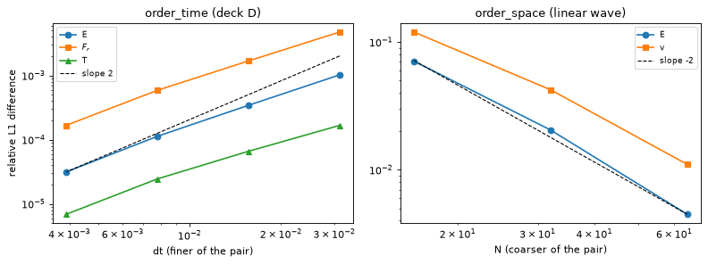

   Relative L1 difference of successive levels against dt (left, deck D) and against N (right, linear wave), with a slope-2 line. Pass: order of the finest pair >= 1.7.

.. figure:: figures/radwave.png
   :alt: radwave
   :width: 100%

   Left: decay of radiation-acoustic waves from the free-streaming (x = 0.01) to the trapped limit (x = 100); points code, lines the analytic root. Right: phase-speed and damping errors against x. Pass: phase speed within 3e-3 (dashed), damping within 5e-3 per radian (dotted).

.. figure:: figures/wb.png
   :alt: wb_sp, wb_cs
   :width: 100%

   Largest \|v\|/c_s of an envelope in hydrostatic and radiative equilibrium against time (spherical polar to t = 10, cubed sphere to t = 2.5). Pass: below 1e-8 (dashed).

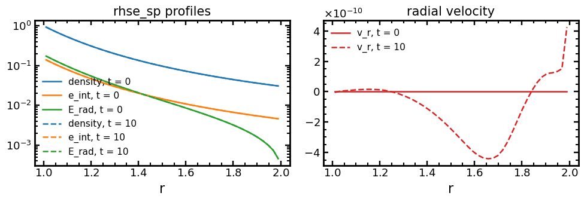

   The spherical-polar envelope at t = 0 and t = 10: density, internal and radiation energy (left; the curves overlap) and the radial velocity, of order 1e-10 (right).

.. figure:: figures/wedge_sym.png
   :alt: wedge_sym
   :width: 100%

   Left: F_phi per phi column on the 20, 3.7 and 7.3 deg wedges. Right: the wedge-mean \|ΣF_phi\| / Σ\|F_r\| of each wedge. Pass: below 1e-8 (dashed); the 3.7 deg wedge without ``vet_gd_wall_sym`` stops with the wedge FATAL.

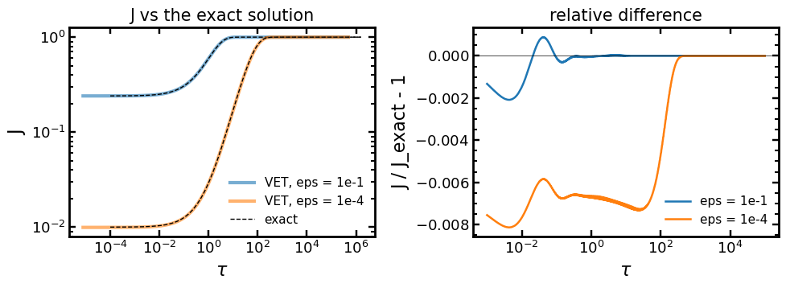

   Mean intensity J against optical depth in a two-level-atom atmosphere (epsilon = 0.1 and 1e-4) with the exact transport solution (left) and the relative difference (right). Pass: L1 within 5 % of the reference value.

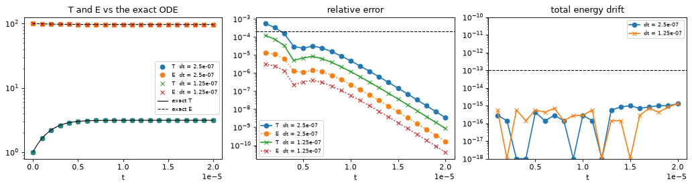

   Gas temperature and radiation energy relaxing to equilibrium against the exact ODE at two time steps (left), their relative errors (middle) and the total-energy drift (right). Pass: T error below 2e-4 (dashed), order >= 1.8, energy drift below 1e-13 (dashed).

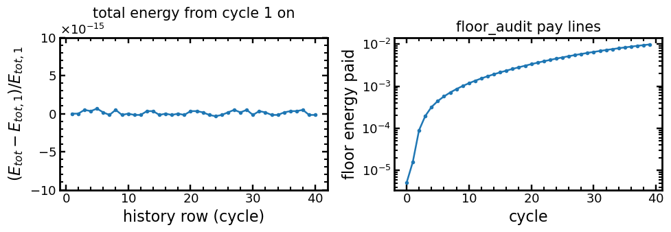

   A temperature floor that acts in most cells every cycle, paid from the radiation: total-energy drift from cycle 1 on (left) and the floor energy paid per cycle (right). Pass: drift below 1e-13, energy paid > 0, unpaid 0, no ``CLEAN WARNING``.

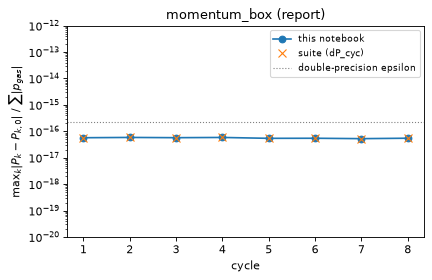

   Linear-momentum drift max_k \|P_k - P_k,0\| / Σ\|p_gas\| per cycle in a periodic 3-D box (gas + radiation face momenta). A report, no criterion; here at round-off.

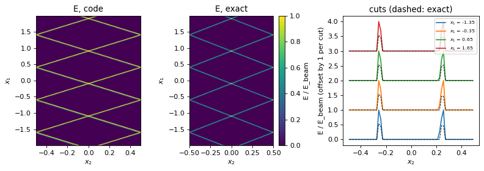

   Two beams crossing in vacuum at ±45 deg: E of the run and the exact straight beams (images) and cuts across the beams at four heights (dashed: exact). The beams stay 1-2 cells wide; an oblique sub-cell beam carries about 1.8 x the exact energy. Pass: L1 of E and the beam energy within 5 % of 0.777 and 1.785.

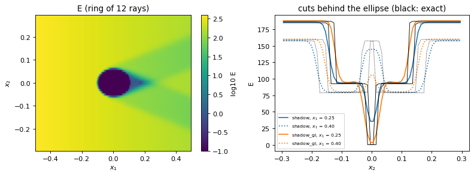

   Two beams past an opaque ellipse: log E of the ring run (left) and cuts behind the ellipse for the ring and the general 8 x 32 ray set against the exact attenuated beams (right). Pass: L1 within 5 % of 0.0138 and 0.0126.

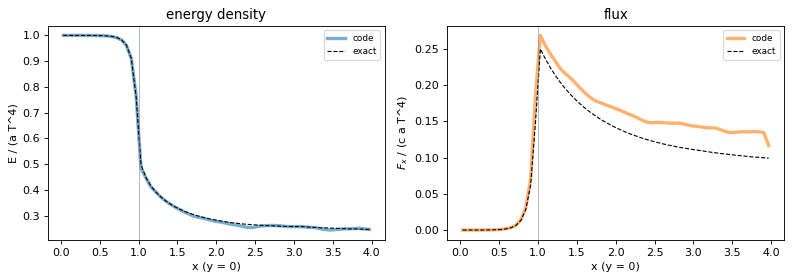

   Homogeneous emitting cylinder (r < 1): E and F_x/c along y = 0 against exact transport. Pass: L1 of E inside, E outside and F outside within 5 % of 5.3e-4, 0.011, 0.203.

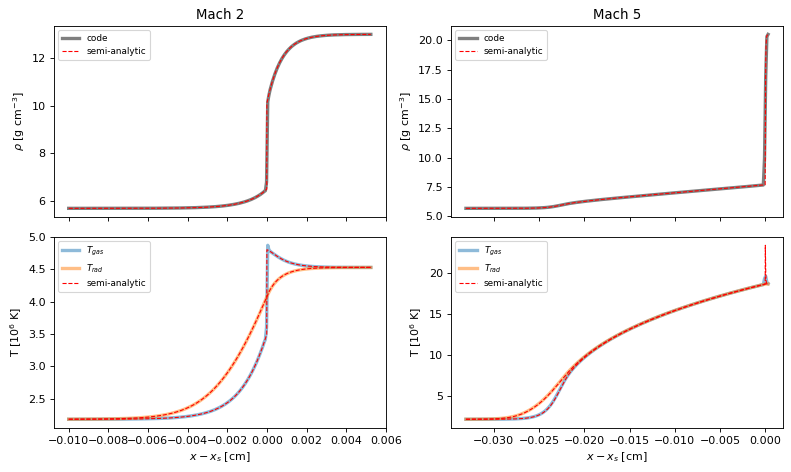

   Lowrie & Edwards radiative shocks at Mach 2 and 5: density and gas and radiation temperatures against the semi-analytic profiles (dashed), no shift. Pass: L1 of rho, v, T_gas, T_rad each within 5 % of the reference.

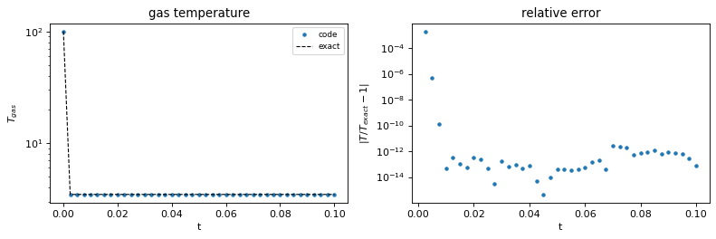

   Hot gas cooling into radiation at dt = 5 to 1e5 relaxation times: T(t) against the exact ODE and the relative error. Pass: error within 5 % of 2.0e-3, energy drift below 1e-13.

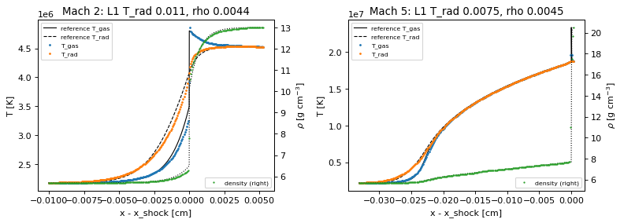

   Lowrie & Edwards radiative shocks at Mach 2 (left, subcritical) and Mach 5 (right, supercritical) after 2e-10 s on 256 cells: gas and radiation temperature and density (points) against the semi-analytic profile (lines). Pass: L1 of rho and T_rad within 5 % of the reference values (about 0.5 % and 1 %), every L1 below 1-2 %, no ``CLEAN WARNING``.

.. figure:: figures/diffusion.png
   :alt: diffusion
   :width: 100%

   Left: a Gaussian pulse diffusing in a static scatterer at tau_cell = 1, 10 and 1e5 against the exact diffusion solution. Middle: error of the diffusion coefficient against tau_cell (1-D and 2-D). Right: a top-hat at tau_cell = 1e4. Pass: \|growth/(2 D t) - 1\| <= 2e-3 at tau_cell >= 10 (dashed), the top-hat within its initial bounds.

.. figure:: figures/marshak.png
   :alt: marshak
   :width: 100%

   Non-equilibrium Marshak wave: radiation energy (solid) and gas temperature (dashed) relative to the bath at t = 50 ... 200, and the front at t = 200. Pass: positive and below the bath, front within 5 % of the reference (no analytic solution for constant c_v).

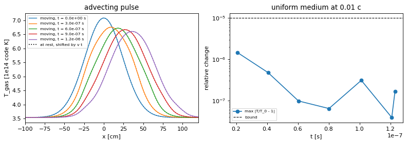

   Left: a diffusing radiation pulse advected at 3e7 cm/s (solid) against the same pulse at rest shifted by v t (dotted). Right: the largest change of T in a uniform medium moving at 0.01 c. Pass: L1 <= 3e-3; change <= 1e-5 (dashed).

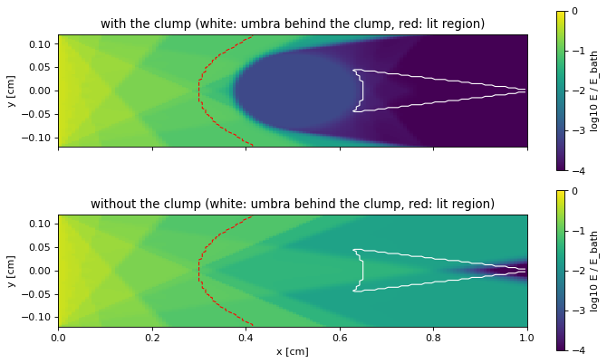

   log10 E / E_bath with (top) and without (bottom) an opaque clump lit from the left by a 1740 K bath; white: the geometric umbra behind the clump, red dashed: the region whose sight lines miss the clump. Pass: <= 2 % of the radiation left in the umbra (measured 0.6 %), the lit region unchanged to 2 %.
