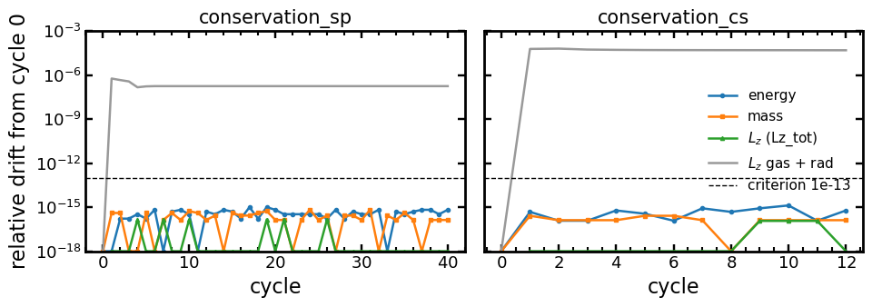
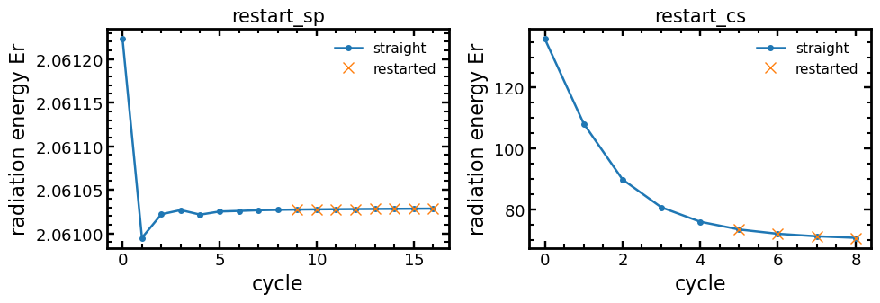
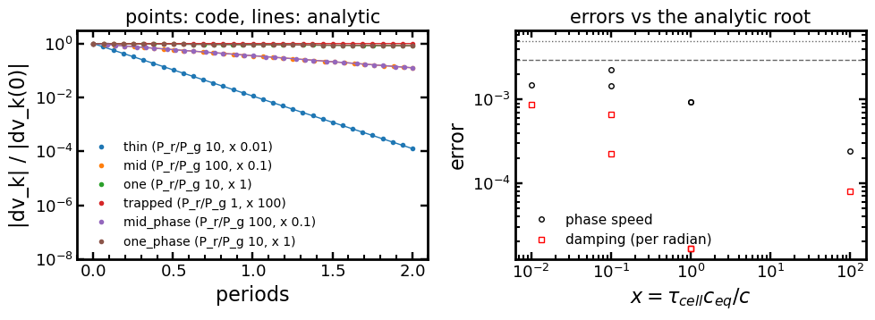
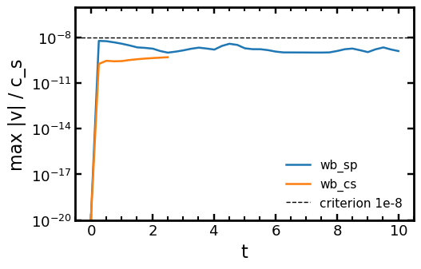
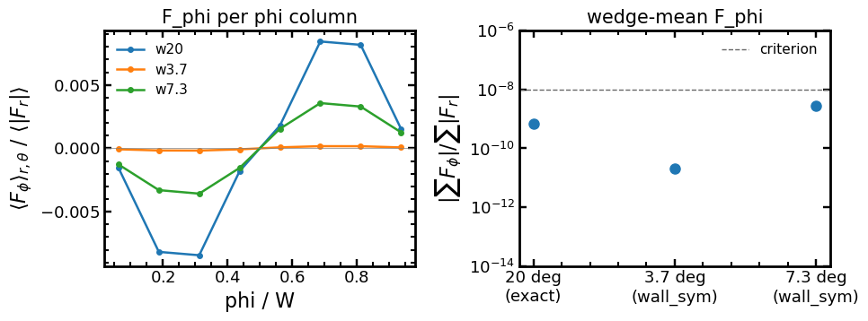
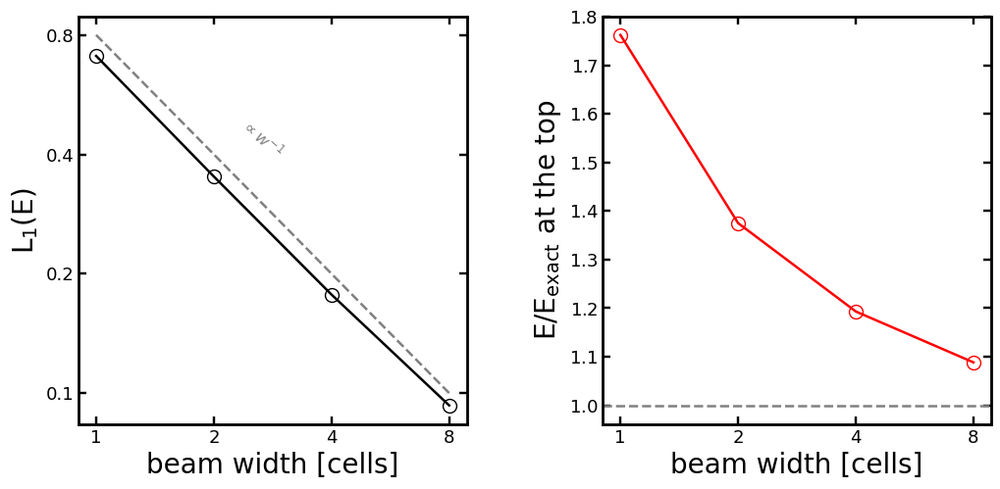
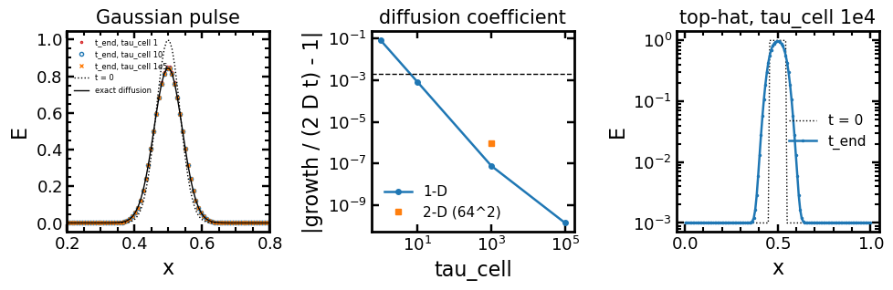
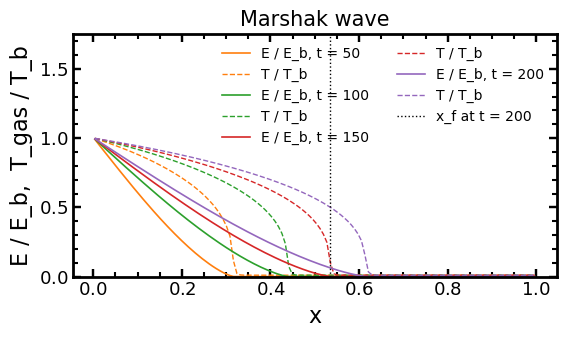

.. This page is generated by tools/sync_from_code.py from tests/vet_clean/README.md of the code
   repository. Edit the Markdown there and re-run the script.

Tests
=====

A self-contained CPU test suite for the clean VET radiation scheme: one command, a PASS / FAIL
line per test, about 1 min (``--quick``) or 5 min (full) on 48 cores (``--jobs 12``).

.. code:: bash

   # build a CPU binary (into build_vettest/) and run the quick subset
   tests/vet_clean/run_tests.sh --quick
   # or test a binary you built yourself
   tests/vet_clean/run_tests.sh --exe build_cpu/src/athena            # full suite
   tests/vet_clean/run_tests.sh --exe build_cpu/src/athena --only restart_sp,dt_retry

Requirements: python3 with numpy (nothing else), and for ``--build`` CMake, MPI (``mpicxx``) and
a C++17 compiler. The binary needs only the built-in problem generators, so the default
build (no ``-D PROBLEM``) is enough. Every test runs on one MPI rank with
OpenMP threads, except ``mpi_ranks`` (2 ranks), which compares the dumps and ``hydro.hst``
(the sums of ``user.hst`` depend on the order of the ranks' partial sums).

Options (``run_tests.py --help``): ``--jobs N`` tests at the same time (default: cores / 4),
``--star-exe PATH`` a binary built with ``-D PROBLEM=star_vet`` (for ``star_smoke`` and
``wb_star``, which are skipped without it), ``--threads T`` OpenMP threads per run (default 4; on a shared node cap ``--jobs``, the default
takes every core), ``--workdir DIR`` (default
``./vet_clean_runs``), ``--keep`` (keep the run directories of passed tests; failed tests are
always kept), ``--record FILE`` (write every measured number to a JSON file), ``--keys 'block/key=value ...'`` (extra input keys for every run, e.g. to test a new key on the whole
suite; a test's own settings win).

Exit status: 0 if all tests pass, 1 otherwise. A test whose run fails (non-zero return code)
is a FAIL with the path of its ``run.log``.

What the tests check
--------------------

+----------------------+----------------------+------------------------------------------+----------------------------+
| test                 | deck                 | what                                     | criterion                  |
+======================+======================+==========================================+============================+
| ``conservation_sp``  | ``shell_sp``         | closed rotating shell, 3-D spherical     | dE/E, dM/M, dLz <= 1e-13   |
|                      |                      | polar, 40 cycles (16 quick): total       |                            |
|                      |                      | energy (gas + radiation), mass, total    |                            |
|                      |                      | L_z                                      |                            |
+----------------------+----------------------+------------------------------------------+----------------------------+
| ``conservation_cs``  | ``shell_cs``         | the same on a cubed sphere, 12 cycles    | as above                   |
+----------------------+----------------------+------------------------------------------+----------------------------+
| ``mpi_ranks``        | ``shell_sp``,        | 2 MPI ranks against 1 on the same        | maxdiff = 0,               |
|                      | ``shell_cs``         | MeshBlocks, 6 / 4 cycles: the            | ``CLEAN FCONE_LZ`` lines   |
|                      |                      | ``floorcap_spin`` keys on both meshes    | present                    |
|                      |                      | (every ``CLEAN`` counter and report line |                            |
|                      |                      | on) and ``floor_pay`` with               |                            |
|                      |                      | ``floor_audit_worst``; dumps and hydro   |                            |
|                      |                      | histories bitwise. Needs an MPI build    |                            |
|                      |                      | and launcher (``--mpirun``), else        |                            |
|                      |                      | skipped                                  |                            |
+----------------------+----------------------+------------------------------------------+----------------------------+
| ``conservation_lz``  | ``shell_sp``,        | the rotating shells with every L_z-exact | dE, dM, dLz <= 1e-13 on    |
|                      | ``shell_cs``         | cap / cut on (``clean_stag_fcone_lz``,   | both, dLz_gr <= 1e-13 on   |
|                      |                      | ``clean_lz_spin``,                       | sp (cs: reported, as       |
|                      |                      | ``clean_stag_fcone_emax``,               | conservation_cs); restart  |
|                      |                      | ``clean_wb_mcap``, ``floor_from_ekin``   | and retry bitwise; no      |
|                      |                      | with ``vceil = 5e-3``, ``floorcap_lz``   | ``CLEAN WARNING``          |
|                      |                      | on every cell), 40 / 12 cycles; restart  |                            |
|                      |                      | 8 + 8 and a forced dt_retry (factor 1)   |                            |
|                      |                      | with the same keys                       |                            |
+----------------------+----------------------+------------------------------------------+----------------------------+
| ``floorcap_spin``    | ``shell_sp``,        | the ``conservation_lz`` keys +           | dE, dM, dLz <= 1e-13 on    |
|                      | ``shell_cs``         | ``floorcap_lz_spin`` with                | both, dLz_gr <= 1e-13 on   |
|                      |                      | ``floorcap_rho = gas_rho`` (cells that   | sp; capped cells > 0;      |
|                      |                      | thin below the IC density are floor gas, | restart, retry and layout  |
|                      |                      | capped at 5e-3; the rest take the rigid  | bitwise; no                |
|                      |                      | rotation), 40 / 12 cycles; restart 8 +   | ``CLEAN WARNING``          |
|                      |                      | 8, a forced dt_retry (factor 1), 1 vs 1  |                            |
|                      |                      | x 2 MeshBlocks in tile mode; the same    |                            |
|                      |                      | without ``floorcap_lz`` for information  |                            |
+----------------------+----------------------+------------------------------------------+----------------------------+
| ``floor_dt``         | ``shell_sp``         | ``hydro/dt_floor_courant = 0.6`` with    | dE <= 1e-13; restart and   |
|                      |                      | floor gas (``floorcap_rho = 100``), 16   | retry bitwise; dt_gain     |
|                      |                      | cycles; restart 8 + 8 and a forced       | reported; no               |
|                      |                      | dt_retry                                 | ``CLEAN WARNING``          |
+----------------------+----------------------+------------------------------------------+----------------------------+
| ``merge_lat``        | ``merge_sp``,        | merged lateral groups                    | dM, dLz, dE, every group's |
|                      | ``merge_cs``,        | (``hydro/merge_lat_rc``, f = 4, 2,       | change of M, E, sum V m_r, |
|                      | ``shell_sp``         | ``merge_lat_mom = radial``): cell noise  | L and the lateral velocity |
|                      |                      | (density x 1e6, supersonic) 200 / 100    | of a radial flow <= 1e-13; |
|                      |                      | cycles on both meshes, radial flow, the  | restart, forced dt_retry,  |
|                      |                      | radiating shell; ``rigid`` on the same   | 1 vs 2 x 2 MeshBlocks (sp) |
|                      |                      | noise                                    | bitwise; ``rigid`` must    |
|                      |                      |                                          | drift in L_z (>= 1e-8)     |
+----------------------+----------------------+------------------------------------------+----------------------------+
| ``restart_fixes``    | ``shell_cs``,        | a restart file without                   | named with the old value:  |
|                      | ``fofc_cs``,         | ``clean_cs_lat_wb``,                     | bitwise the run that       |
|                      | ``merge_sp``,        | ``fofc_flag_exchange``,                  | stored it; not named: the  |
|                      | ``shell_sp``         | ``merge_lat_mom``,                       | NOTE "the fix applies", no |
|                      |                      | ``merge_lat_blockend``,                  | ``CLEAN WARNING``, a       |
|                      |                      | ``time2_gtime_slope`` /                  | different run; the stored  |
|                      |                      | ``time2_gtime_pos`` (written with the    | old value prints its own   |
|                      |                      | old value, the key's line then removed   | NOTE                       |
|                      |                      | from it)                                 |                            |
+----------------------+----------------------+------------------------------------------+----------------------------+
| ``restart_sp``       | ``shell_sp``         | 16 cycles straight vs 8 + restart + 8    | every dump and history row |
|                      |                      |                                          | identical (difference 0)   |
+----------------------+----------------------+------------------------------------------+----------------------------+
| ``restart_cs``       | ``shell_cs``         | 8 straight vs 4 + restart + 4            | identical                  |
+----------------------+----------------------+------------------------------------------+----------------------------+
| ``dt_retry``         | ``shell_sp``         | a forced step retry at cycle 4 with      | factor 1: identical to the |
|                      |                      | factor 1 (the step is repeated at the    | run without retry; factor  |
|                      |                      | same dt) and with factor 0.5             | 0.5: runs on; one retry    |
|                      |                      |                                          | each                       |
+----------------------+----------------------+------------------------------------------+----------------------------+
| ``layout_tile``      | ``shell_sp`` (16 x   | ``<mesh>/layout_invariant_mode = tile``, | 1 x 2: identical           |
|                      | 16 lateral)          | ``layout_tile = 8``, 8 cycles: 1         | (difference 0); 2 x 2:     |
|                      |                      | MeshBlock vs 1 x 2 MeshBlocks (along     | largest difference /       |
|                      |                      | phi) and vs 2 x 2 (theta x phi, vacuum   | largest value <= 1e-8 (see |
|                      |                      | ray walls)                               | below); the 1 x 2 pair     |
|                      |                      |                                          | again with                 |
|                      |                      |                                          | ``dfloor_flux_limit`` and  |
|                      |                      |                                          | ``dfloor`` just below the  |
|                      |                      |                                          | gas density (the limiter   |
|                      |                      |                                          | acts in every cell):       |
|                      |                      |                                          | identical, and its dE, dM, |
|                      |                      |                                          | dLz <= 1e-13               |
+----------------------+----------------------+------------------------------------------+----------------------------+
| ``fofc_layout_cs``   | ``fofc_cs``          | hydro shell on the cubed sphere whose    | identical; E, L_z drifts   |
|                      |                      | fluxes FOFC replaces (density floor, cfl | of the 2 x 2 run, M drift  |
|                      |                      | 0.8), 8 cycles: one MeshBlock per panel  | of a fast shell without    |
|                      |                      | vs 2 x 2, 2 along r and 2 x 2 x 2;       | the density floor <= 1e-13 |
|                      |                      | restart and a forced dt_retry of the 2 x |                            |
|                      |                      | 2 run                                    |                            |
+----------------------+----------------------+------------------------------------------+----------------------------+
| ``order_time``       | ``deckD``            | time step halved at a fixed grid (3      | order of the finest pair   |
|                      |                      | levels quick, 5 full);                   | >= 1.7; errors within 5 %  |
|                      |                      | successive-difference L1 of E, F_r, T    | of the reference           |
+----------------------+----------------------+------------------------------------------+----------------------------+
| ``order_stiff``      | ``wave_cart``        | radiation-acoustic wave in the trapped   | order of the finest pair   |
|                      |                      | regime (x = 100, P_rad/P_gas 1), time    | >= 1.7; errors within 5 %  |
|                      |                      | step T/64 ... T/512, strict solves (full | of the reference           |
|                      |                      | only)                                    |                            |
+----------------------+----------------------+------------------------------------------+----------------------------+
| ``order_space``      | ``wave_cart``        | linear radiation-hydro wave, one period, | order of the finest pair   |
|                      |                      | N = 16 ... 128 cells with dt following   | >= 1.7 (full only)         |
|                      |                      | the CFL                                  |                            |
+----------------------+----------------------+------------------------------------------+----------------------------+
| ``nlte_eps1e-1``,    | ``nlte_eps*``        | two-level-atom non-LTE atmosphere (Jiang | L1 within 5 % of the       |
| ``nlte_eps1e-4``     |                      | 2021, ApJS 253, 49, sec. 4.5): J vs the  | reference value            |
|                      |                      | exact transport solution                 |                            |
|                      |                      | (``ref/nlte_exact_eps*.txt``)            |                            |
+----------------------+----------------------+------------------------------------------+----------------------------+
| ``thermal_eq``       | ``thermal_eq``       | uniform gas + radiation relaxing to      | max relative error of      |
|                      |                      | equilibrium (Jiang 2021, sec. 4.1) vs    | E(t), T(t) <= bound        |
|                      |                      | the exact ODE                            |                            |
+----------------------+----------------------+------------------------------------------+----------------------------+
| ``mhd_equil``        | ``mhd_equil``        | the relaxing uniform box with ``<mhd>``, | starts; gas + radiation    |
|                      |                      | ``eos = general`` and a uniform field,   | energy and field <= 1e-13; |
|                      |                      | every other ``<mhd>`` key at its         | 3 FATALs; no               |
|                      |                      | default, 10 cycles; keys of ``<hydro>``  | ``CLEAN WARNING``          |
|                      |                      | only under ``<mhd>``                     |                            |
+----------------------+----------------------+------------------------------------------+----------------------------+
| ``wb_sp``, ``wb_cs`` | ``rhse_sp``,         | grey scattering envelope in hydrostatic  | max over the run of max    |
|                      | ``rhse_cs``          | and radiative equilibrium (spherical     |                            |
|                      |                      | polar 2-D, cubed sphere); again with a   |                            |
|                      |                      | rotating set (``_rot``: sp GL 11 x 12    |                            |
|                      |                      | turning about z every 2, cs GL 10 x 12   |                            |
|                      |                      | about a 3-D axis every 0.5; EMA ring,    |                            |
|                      |                      | cross-fade,                              |                            |
|                      |                      | ``vet_rotate_avg_ema_wb = true``)        |                            |
+----------------------+----------------------+------------------------------------------+----------------------------+
| ``shell_force_cs``   | ``shell_cs``         | the opaque shell (``kappa_s = 300``) at  | rms lateral / rms radial   |
|                      |                      | rest and spherically symmetric, 8        | velocity and rms of the    |
|                      |                      | cycles: the radiation pushes the gas     | radial velocity about its  |
|                      |                      | along r alone, the same in every cell of | shell mean / rms radial    |
|                      |                      | a shell (``clean_cs_lat_wb``; ``wb_cs``  | velocity: lat <= 3e-4, rad |
|                      |                      | withholds the static force and cannot    | <= 2e-4 (6e-5 and 6e-5;    |
|                      |                      | see this)                                | 2.4e-3 and 6.4e-4 without  |
|                      |                      |                                          | the key)                   |
+----------------------+----------------------+------------------------------------------+----------------------------+
| ``eddington_cs``     | ``shell_cs``         | ``clean_closure = eddington`` with       | drift of E, M, L_z <=      |
|                      |                      | ``vet_gd`` set, 4 cycles (no rays are    | 1e-13; restart identical;  |
|                      |                      | swept; the solve read their face sums    | on and off agree to 1e-10  |
|                      |                      | and crashed), its restart pair, and      | (3e-14); no                |
|                      |                      | ``clean_consistency = false`` with       | ``CLEAN WARNING``          |
|                      |                      | ``vet_gd`` on and off                    |                            |
+----------------------+----------------------+------------------------------------------+----------------------------+
| ``radwave``          | ``wave_cart`` (80 x  | linear radiation-acoustic wave           | phase speed within 3e-3,   |
|                      | 4, x on 64 cells)    | (amplitude 1e-3, at 1e-6 the thin wave   | damping within 5e-3 per    |
|                      |                      | ends below the solver tolerance; the     | radian, no growth; dt gain |
|                      |                      | exact eigenmode, 2 periods, cfl 0.3) at  | of the diff key within 2 % |
|                      |                      | P_rad/P_gas, x = (10, 0.01), (100, 0.1), | of 2.77; the phase key's   |
|                      |                      | (10, 1), (1, 100), x = tau_cell c_eq / c | dt >= the diff key's (2.15 |
|                      |                      | the grid-scale trapping parameter;       | at x = 0.1, 1 at x = 1)    |
|                      |                      | ``mid_phase`` is 3.17e-3 at N = 64       |                            |
|                      |                      | (bound 3e-3; 2.26e-3 at 80), and the     |                            |
|                      |                      | thin phase error of 2e-5 that N = 64     |                            |
|                      |                      | used to show was a cancellation of time  |                            |
|                      |                      | and space errors (1.1e-3 at cfl 0.15);   |                            |
|                      |                      | phase speed and damping of a k = 1 fit   |                            |
|                      |                      | vs the analytic root                     |                            |
|                      |                      | (``vett.radwave_root``); the x = 0.01    |                            |
|                      |                      | case also without                        |                            |
|                      |                      | ``hydro/rad_signal_speed_diff``, x = 0.1 |                            |
|                      |                      | and 1 also with                          |                            |
|                      |                      | ``hydro/rad_signal_speed_phase`` (full   |                            |
|                      |                      | only, ~1 min)                            |                            |
+----------------------+----------------------+------------------------------------------+----------------------------+
| ``wedge_sym``        | ``shell_sp``         | the shell at rest, spherically           | fphi, fth, fth_rot <=      |
|                      |                      | symmetric, GL 7 x 18 rays, 8 cycles, on  | 1e-8; the runs without     |
|                      |                      | a 20 deg wedge and (with                 | their key, and 10 x 12,    |
|                      |                      | ``vet_gd_wall_sym = true``) 3.7 and 7.3  | stop with the FATAL        |
|                      |                      | deg wedges: fphi = \|Σ F_phi\| / Σ       |                            |
|                      |                      | \|F_r\|; the 3.7 deg wedge without the   |                            |
|                      |                      | key; the 20 deg shell made               |                            |
|                      |                      | theta-periodic with                      |                            |
|                      |                      | ``vet_gd_theta_seam_sym = true``: fth =  |                            |
|                      |                      | \|Σ F_theta\| / Σ \|F_r\|, and without   |                            |
|                      |                      | the key; the theta-periodic 30 deg wedge |                            |
|                      |                      | with GL 11 x 12 turning about z (EMA     |                            |
|                      |                      | ring, cross-fade): fth_rot, and GL 10 x  |                            |
|                      |                      | 12 staggered (no mirror)                 |                            |
+----------------------+----------------------+------------------------------------------+----------------------------+
| ``floor_pay``        | ``shell_sp``         | ``hydro/eos = general``, ``tfloor`` just | dE <= 1e-13; floor energy  |
|                      |                      | above the gas temperature (the floor     | paid > 0, unpaid 0; ekin   |
|                      |                      | acts in most cells every cycle),         | dE, dM, dLz <= 1e-13; no   |
|                      |                      | ``floor_pay = rad_column``,              | ``CLEAN WARNING``          |
|                      |                      | ``floor_pay_skip``,                      |                            |
|                      |                      | ``dfloor_flux_limit``,                   |                            |
|                      |                      | ``floor_audit = 1``, 40 cycles:          |                            |
|                      |                      | total-energy drift from t = 0; then 16   |                            |
|                      |                      | cycles with ``floor_from_ekin = true``   |                            |
|                      |                      | and ``vceil = 1.2e-2``: energy, mass and |                            |
|                      |                      | L_z drift                                |                            |
+----------------------+----------------------+------------------------------------------+----------------------------+
| ``star_smoke``       | ``star_small``       | the star3d_sp deck on 256 x 8 x 8 cells  | every history column of    |
|                      |                      | with the production scheme keys and the  | ``STAR_COLS`` within 2e-4  |
|                      |                      | BSG tables, 20 cycles, ~15 s (needs      | of the stored history      |
|                      |                      | ``--star-exe``, a                        | ``ref/star_smoke.*.hst``   |
|                      |                      | ``-D PROBLEM=star_vet`` binary)          | (relative to its maximum); |
|                      |                      |                                          | the two files are in git   |
|                      |                      |                                          | (``.gitignore`` excepts    |
|                      |                      |                                          | them): re-record both by   |
|                      |                      |                                          | copying                    |
|                      |                      |                                          | ``bsg3d.{user,hydro}.hst`` |
|                      |                      |                                          | of the run when the scheme |
|                      |                      |                                          | is meant to change; no     |
|                      |                      |                                          | ``CLEAN WARNING``          |
+----------------------+----------------------+------------------------------------------+----------------------------+
| ``wb_star``          | ``star_small``       | the stars' well-balance mode (dynamic,   | **a report, not a          |
|                      |                      | ``wb_x1``,                               | criterion**: the column is |
|                      |                      | ``force_reference = wb_arad``) on the    | not in discrete            |
|                      |                      | unseeded BSG column, 20 cycles (needs    | equilibrium with its own   |
|                      |                      | ``--star-exe``)                          | opacities, so v/c_s        |
|                      |                      |                                          | reaches 3e-3 in the        |
|                      |                      |                                          | interior (r < 2.9e12 cm)   |
|                      |                      |                                          | and 0.7 at the photosphere |
|                      |                      |                                          | and in the floor gas;      |
|                      |                      |                                          | lateral velocity 1.4e-11   |
|                      |                      |                                          | outside the merged-cell    |
|                      |                      |                                          | radius; no                 |
|                      |                      |                                          | ``CLEAN WARNING``          |
+----------------------+----------------------+------------------------------------------+----------------------------+
| ``ceiling_metric``   | ``shell_sp``,        | the rotating shells (``gas_rot = 0.3``,  | dvphi, dcap, vtheta <=     |
|                      | ``shell_cs``         | ``gas_vr = 0.2``, r 1-3),                | 1e-13; scale_ok            |
|                      |                      | ``hydro/eos = general``,                 |                            |
|                      |                      | ``floor_from_ekin = true``,              |                            |
|                      |                      | ``vceil = 0.5`` (below \|v\| in 1408 /   |                            |
|                      |                      | 2928 cells) against the same run without |                            |
|                      |                      | the ceiling, cell by cell at t = 0 (cs:  |                            |
|                      |                      | the velocity rebuilt from the            |                            |
|                      |                      | contravariant v^a on the unit tangents,  |                            |
|                      |                      | \|V\| the metric norm): v_phi kept       |                            |
|                      |                      | (L_z), \|V\| = max(vceil, \|v_phi\|)     |                            |
|                      |                      | where capped, else unchanged, v_theta 0, |                            |
|                      |                      | the radial part scaled in [0, 1]. A      |                            |
|                      |                      | ceiling on Σ v_a² of mixed components or |                            |
|                      |                      | a split along the covariant phi          |                            |
|                      |                      | component fails it on cs (dvphi 0.31).   |                            |
|                      |                      | The cell-level C++ test                  |                            |
|                      |                      | ``unit/ceiling_cell.cpp`` (build line in |                            |
|                      |                      | its header) checks the same, the tfloor  |                            |
|                      |                      | payment and the heat = metric KE change, |                            |
|                      |                      | at corner and ghost-extended points of   |                            |
|                      |                      | all six panels, on sp, Cartesian and cs  |                            |
+----------------------+----------------------+------------------------------------------+----------------------------+
| ``floor_momentum``   | ``wave_cart`` (8^3), | the momentum ledger of the inversions'   | box and shells <= 1e-12;   |
|                      | ``shell_sp``,        | floors (``CLEAN FLOORMOM``): periodic    | momentum removed in the    |
|                      | ``shell_cs``         | box of sound waves (amplitude 0.2,       | box >= 1e-6; the same      |
|                      |                      | negligible radiation) with               | lines; no                  |
|                      |                      | ``floor_from_ekin``, with ``vceil`` and  | ``CLEAN WARNING``          |
|                      |                      | with both, and with the energy exchange  |                            |
|                      |                      | (``exch_ratio``), per cycle \|P(n+1) -   |                            |
|                      |                      | P(n) - ledger\| / Σ|p_gas\|; the t = 0   |                            |
|                      |                      | inversion of the rotating expanding      |                            |
|                      |                      | shells against the dumps' p_r; restart,  |                            |
|                      |                      | forced dt_retry, 1 vs 2 MeshBlocks       |                            |
+----------------------+----------------------+------------------------------------------+----------------------------+
| ``momentum_box``     | ``wave_cart`` (8^3,  | total linear momentum, gas (``hydro_u``) | **a report, not a          |
|                      | periodic 3-D)        | + radiation (face momenta of             | criterion**: passes when   |
|                      |                      | ``vet_face`` / c^2), every cycle for 8   | the run completes, the     |
|                      |                      | cycles; radiation wave along the xyz     | numbers are finite and     |
|                      |                      | diagonal, amplitude 1e-3,                | there is no                |
|                      |                      | ``radwave_eig = false``, ``nghost = 3``, | ``CLEAN WARNING``          |
|                      |                      | tile 8: ``dP_cyc`` = largest component   |                            |
|                      |                      | of \|P - P_0\| / Σ|p_gas\| per cycle,    |                            |
|                      |                      | ``dP_max`` its maximum (quick and full,  |                            |
|                      |                      | ~10 s)                                   |                            |
+----------------------+----------------------+------------------------------------------+----------------------------+

IDORT literature tests
~~~~~~~~~~~~~~~~~~~~~~

The literature tests of the IDORT paper (Ma et al. 2025, sec. 4.1) and Jiang (2021, ApJS 253,
49) with the production keys, each against an exact or semi-analytic solution (decks
``idort_*``; the two-level-atom atmospheres are ``nlte_eps1e-1`` and ``nlte_eps1e-4`` above, the
fast-relaxation thermal equilibrium is ``thermal_eq``). L1 is sum \|q - q_exact\| / sum \|q_exact\|.

+------------------------+-----------------------+------------------------------------+----------------------+
| test                   | deck                  | what                               | criterion            |
+========================+=======================+====================================+======================+
| ``idort_beams``        | ``idort_beams``       | two beams, 4 cells wide, crossing  | L1 and ``lum_top``   |
|                        |                       | in vacuum at +-45 deg (256 x 64,   | within 5 % of 0.1772 |
|                        |                       | x2 periodic, ring of 4 rays): E vs | and 1.193            |
|                        |                       | the exact straight beams (cell     | (regression          |
|                        |                       | averages); ``lum_top`` the energy  | references, see      |
|                        |                       | of the row 3 cells below x1max vs  | below); ``flux_err`` |
|                        |                       | exact; ``flux_err`` the x1 energy  | <= 1e-5              |
|                        |                       | flux (``vet_phi1``) through every  |                      |
|                        |                       | row vs the injected flux           |                      |
+------------------------+-----------------------+------------------------------------+----------------------+
| ``idort_beams_mb``     | ``idort_beams``       | the beams on 4 MeshBlocks vs 1:    | tile x2: identical;  |
|                        |                       | along x2 in tile mode              | block x1: largest    |
|                        |                       | (``layout_tile = 16``), along x1   | difference <= 1e-8   |
|                        |                       | in block mode                      |                      |
+------------------------+-----------------------+------------------------------------+----------------------+
| ``idort_shadow``,      | ``idort_shadow*``     | two beams at +-15 deg past an      | L1 within 5 % of     |
| ``idort_shadow_gl``    |                       | opaque ellipse (128 x 64; ring of  | 0.0138 and 0.0126    |
|                        |                       | 12 rays, or the general 8 x 32 set |                      |
|                        |                       | with the beams snapped to its      |                      |
|                        |                       | rays): E vs the exact attenuated   |                      |
|                        |                       | beams                              |                      |
+------------------------+-----------------------+------------------------------------+----------------------+
| ``idort_cylinder``     | ``idort_cylinder``    | homogeneous emitting cylinder (rho | each L1 within 5 %   |
|                        |                       | kappa = 10, a T^4 = 1) in vacuum,  | of 5.3e-4, 0.011,    |
|                        |                       | 128 x 128: E inside and outside,   | 0.0116, 0.203        |
|                        |                       | the energy flux Phi_x              |                      |
|                        |                       | (``vet_phi1``, ``F_out``) and the  |                      |
|                        |                       | face momentum F_x (``vet_f1``,     |                      |
|                        |                       | ``FH_out``) outside along y = 0 vs |                      |
|                        |                       | the exact transport solution       |                      |
|                        |                       | (``ref/idort_cylinder_exact.npz``) |                      |
+------------------------+-----------------------+------------------------------------+----------------------+
| ``idort_radshock_m2``, | ``idort_radshock_m*`` | Lowrie & Edwards (2008) radiative  | each L1 within 5 %   |
| ``_m5``                |                       | shocks, Mach 2 and 5, 256 cells,   | of the reference     |
|                        |                       | started from the semi-analytic     | (2.1e-4 ... 1.7e-3)  |
|                        |                       | profile                            |                      |
|                        |                       | (``ref/idort_radshock_m*.txt``,    |                      |
|                        |                       | its absolute path set by           |                      |
|                        |                       | ``run_tests.py``) with the         |                      |
|                        |                       | Eddington closure of the           |                      |
|                        |                       | diffusion-theory reference         |                      |
|                        |                       | (``clean_closure = eddington``):   |                      |
|                        |                       | rho, v, T_gas, T_rad at t = 2e-10  |                      |
|                        |                       | s, no shift                        |                      |
+------------------------+-----------------------+------------------------------------+----------------------+
| ``idort_thermal_eq2``  | ``idort_thermal_eq2`` | hot gas cooling into radiation     | max error within 5 % |
|                        |                       | (Jiang 2021 sec. 4.1), dt = 5 to   | of 2.0e-3;           |
|                        |                       | 1e5 relaxation times: T(t) vs the  | total-energy drift   |
|                        |                       | exact ODE                          | <= 1e-13             |
+------------------------+-----------------------+------------------------------------+----------------------+

``idort_shadow`` and ``idort_shadow_gl`` are in ``--quick``; the eight take about 45 s with
``--jobs 8``. The beams and shadow exact fields are computed in ``run_tests.py``; the cylinder's
(``ref/idort_cylinder_exact.npz``, x > 0 on the 128-cell grid) is the transport integral over 64
Gauss polar angles x 4096 azimuths and the cylinder's periodic images. Notes:

- **Beams.** The 4-cell beams stay straight, at their angle and 0.8 cells wider at half maximum
  than the exact ones, but carry 1.19 x the exact energy (``lum_top``): the cap of the streaming
  share at the beam edges. They cross and go on: the field differs from the sum of the two
  single-beam fields by more than 0.05 E_b only in 40 of the 256 rows, around the crossings
  (1.3 % of the energy; the largest E is 1.13 x the exact). The excess falls as the beam
  widens: 1.76, 1.38, 1.19, 1.09 x at 1, 2, 4, 8 cells (L1 0.71, 0.35, 0.18, 0.093).
  Both are regression references. The energy flux through every row equals the injected flux
  to 6e-8 (``flux_err``).
- **Cylinder flux.** E outside the cylinder is within 1.1 % of exact transport and the
  energy flux Phi (``F_out``, ``vet_phi1``, the flux the method paper measures) within 1.2 %
  (r F at x = 2-3.5 is 0.989 of exact). The face momentum F (``vet_f1``, ``FH_out``) is 20 %
  above exact, a regression reference. The likely
  cause is the harmonic face opacity at the cylinder's sharp edge (not measured).
- **Shocks.** The decks name the production ``time2_tableau = sdirk2``, with its default
  ``time2_gtime_slope``: the L1 values are within 3 % of the method paper's bench table, which
  ran ``hesdirk2`` (Mach 2 and 5); the shock stays at the semi-analytic position (no shift
  needed).

Classic radiation tests
~~~~~~~~~~~~~~~~~~~~~~~

The classic grey radiation tests (group ``radiation``; decks ``decks/rad_*.athinput``, ported from
the former ``inputs/tests/rad_vet_*`` decks, removed because they used the explicit transport, to
the production clean scheme: ``transport = implicit``, ``closure = vet_sc``, the key block of the
other Cartesian decks, Marshak radiation faces).

+----------------------+------------------------+--------------------------------+----------------------+
| test                 | deck                   | what                           | criterion            |
+======================+========================+================================+======================+
| ``radshock``,        | ``rad_radshock_m2``,   | Lowrie & Edwards (2008, Shock  | every L1 <= 1-2 %;   |
| ``radshock_m5``      | ``rad_radshock_m5``    | Waves 18, 129) steady          | L1 of rho, T_rad     |
|                      |                        | radiative shock, Mach 2        | within 5 % of the    |
|                      |                        | (subcritical) and 5            | reference (0.44 %,   |
|                      |                        | (supercritical), 256 cells,    | 1.1 %; Mach 5: 0.39  |
|                      |                        | 2e-10 s from the semi-analytic | %, 0.74 %); E > 0    |
|                      |                        | profile, with the production   |                      |
|                      |                        | closure (``idort_radshock_m*`` |                      |
|                      |                        | runs them with                 |                      |
|                      |                        | ``clean_closure = eddington``; |                      |
|                      |                        | same reference): L1 of rho, v, |                      |
|                      |                        | T_gas, T_rad                   |                      |
+----------------------+------------------------+--------------------------------+----------------------+
| ``diffusion``        | ``rad_diffusion``      | Gaussian pulse in a static     | \|growth/(2 D t) -   |
|                      |                        | pure scatterer at tau_cell =   | 1\| <= 2e-3 (1e-4 in |
|                      |                        | 1, 10, 1e3, 1e5 and in 2-D     | 2-D) at tau_cell >=  |
|                      |                        | (64^2, tau_cell 1e3): variance | 10; L1 within 5 % of |
|                      |                        | growth vs 2 D t, L1 vs the     | the reference;       |
|                      |                        | exact Gaussian; a top-hat at   | top-hat within [bg,  |
|                      |                        | tau_cell = 1e4 (quick and      | bg + amplitude] to   |
|                      |                        | full, ~20 s)                   | round-off; tau_cell  |
|                      |                        |                                | = 1 reported only    |
+----------------------+------------------------+--------------------------------+----------------------+
| ``marshak``          | ``rad_marshak``        | non-equilibrium Marshak wave   | E, T > 0 and <= the  |
|                      |                        | into a cold slab, constant c_v | bath (maximum        |
|                      |                        | (no analytic solution: not Su  | principle); E        |
|                      |                        | & Olson)                       | non-increasing into  |
|                      |                        |                                | the slab; front x_f  |
|                      |                        |                                | (T = T_b/2) within 5 |
|                      |                        |                                | % of the reference   |
|                      |                        |                                | 0.535                |
+----------------------+------------------------+--------------------------------+----------------------+
| ``advect_uniform``   | ``rad_advect_uniform`` | uniform thick medium at 0.01 c | max relative change  |
|                      |                        | at the coupling's fixed point  | of T <= 1e-5, of E   |
|                      |                        | (quick and full, ~3 s)         | <= 1e-4              |
+----------------------+------------------------+--------------------------------+----------------------+
| ``advect_pulse``     | ``rad_advect_pulse``   | diffusing radiation pulse      | L1 <= 3e-3 at every  |
|                      |                        | advected at 3e7 cm/s (Krumholz | dump; the last       |
|                      |                        | et al. 2007) vs the same pulse | within 5 % of        |
|                      |                        | at rest shifted by v t         | 7.75e-4              |
+----------------------+------------------------+--------------------------------+----------------------+
| ``shadow``           | ``rad_shadow``         | opaque clump in a thin gas     | radiation left in    |
|                      |                        | illuminated by a 1740 K bath   | the geometric umbra  |
|                      |                        | (Hayes & Norman 2003), 3       | behind the clump <=  |
|                      |                        | light-crossing times, vs the   | 2 % (measured 0.61   |
|                      |                        | run without the clump          | %); cells whose      |
|                      |                        |                                | sight lines miss the |
|                      |                        |                                | clump unchanged to 2 |
|                      |                        |                                | %                    |
+----------------------+------------------------+--------------------------------+----------------------+

Not ported: ``beam``, ``pulse1d`` (free streaming of a set-up packet in vacuum: the gas is not
initialised by the problem generator and the ``vet_sc`` formal solution has no source there, so
the packet does not move); ``jump``, ``advect_shear`` (no such ``vet_test`` in the problem
generator); ``equil``, ``equil_table`` (= ``thermal_eq``), ``atmosphere`` (= ``nlte_*``);
``g5_pulse2d`` is part of ``diffusion``.

GPU builds
----------

The same suite runs a GPU binary built WITHOUT ``-D PROBLEM`` (the built-in problem
generators; a ``star_vet`` binary cannot run these decks): ``--exe build_tests/src/athena --threads 1 --jobs 1`` (on MI300A also ``export HSA_XNACK=1``). The bitwise tests compare two
runs of one binary and must pass on a GPU too. The reference tests (``order_*``, ``nlte_*``,
``thermal_eq``, ``wb_*``) must agree with the CPU references within their tolerances; a much
larger difference points at the build (see the CUDA 12.2 warning in
:doc:`notes_specific_machines`). On MI300A (ROCm 7.2) ``layout_tile`` finds 1 x 2 MeshBlocks (a phi split) 1.9e-11 from one
MeshBlock, where the CPU is bitwise: on a GPU the 1 x 2 case is bounded, not bitwise.

Notebooks
---------

``notebooks/`` has one Jupyter notebook per test (conservation, thermal equilibrium, order,
well-balancing, non-LTE, momentum box, restart, radiation-acoustic waves, narrow wedges,
floors; ``radiation.ipynb`` for all the classic radiation tests): each runs its test through
this suite (or loads an existing run) and plots the result against the exact solution or the criterion. Only numpy,
matplotlib and jupyter are needed; see :doc:`gallery`.

.. code:: bash

   cd tests/vet_clean/notebooks && ATHENA_EXE=$PWD/../../../build_vettest/src/athena \
     jupyter nbconvert --to notebook --execute --inplace thermal_eq.ipynb

Plots
-----

The key plot of each test, from its notebook (``docs/vet_clean/figures/``).

   Relative drift of total energy, mass and ``Lz_tot`` from cycle 0 on the closed rotating shell (left spherical polar, right cubed sphere; grey: gas + radiation L_z without the ledger). Pass: energy, mass and ``Lz_tot`` below 1e-13 (dashed).

   Radiation energy per cycle of the straight run (dots) and of the run restarted half-way (crosses). Pass: every dump and history row identical (difference 0).

.. figure:: figures/order.png
   :alt: order_time, order_space, order_stiff
   :width: 100%

   Relative L1 difference of successive levels against dt (left, deck D), against N (middle, linear wave) and against the steps per period (right, trapped wave), with a slope-2 line. Pass: order of the finest pair >= 1.7.

   Left: decay of radiation-acoustic waves from the free-streaming (x = 0.01) to the trapped limit (x = 100); points code, lines the analytic root. Right: phase-speed and damping errors against x. Pass: phase speed within 3e-3 (dashed), damping within 5e-3 per radian (dotted).

   Largest \|v\|/c_s of an envelope in hydrostatic and radiative equilibrium against time (spherical polar to t = 10, cubed sphere to t = 2.5). Pass: below 1e-8 (dashed).

.. figure:: figures/wb_2.png
   :alt: wb_sp
   :width: 100%

   The spherical-polar envelope at t = 0 and t = 10: density, internal and radiation energy (left; the curves overlap) and the radial velocity, of order 1e-10 (right).

   Left: F_phi per phi column on the 20, 3.7 and 7.3 deg wedges. Right: the wedge-mean \|ΣF_phi\| / Σ\|F_r\| of each wedge. Pass: below 1e-8 (dashed); the 3.7 deg wedge without ``vet_gd_wall_sym`` stops with the wedge FATAL.

.. figure:: figures/nlte.png
   :alt: nlte_eps1e-1, nlte_eps1e-4
   :width: 100%

   Mean intensity J against optical depth in a two-level-atom atmosphere (epsilon = 0.1 and 1e-4) with the exact transport solution (left) and the relative difference (right). Pass: L1 within 5 % of the reference value.

.. figure:: figures/thermal_eq.png
   :alt: thermal_eq
   :width: 100%

   Gas temperature and radiation energy relaxing to equilibrium against the exact ODE at two time steps (left), their relative errors (middle) and the total-energy drift (right). Pass: T error below 2e-4 (dashed), order >= 1.8, energy drift below 1e-13 (dashed).

.. figure:: figures/floor_pay.png
   :alt: floor_pay
   :width: 100%

   A temperature floor that acts in most cells every cycle, paid from the radiation: total-energy drift from cycle 1 on (left) and the floor energy paid per cycle (right). Pass: drift below 1e-13, energy paid > 0, unpaid 0, no ``CLEAN WARNING``.

.. figure:: figures/momentum_box.png
   :alt: momentum_box
   :width: 100%

   Linear-momentum drift max_k \|P_k - P_k,0\| / Σ\|p_gas\| per cycle in a periodic 3-D box (gas + radiation face momenta). A report, no criterion; here at round-off.

.. figure:: figures/idort_beams.png
   :alt: idort_beams
   :width: 100%

   Two 4-cell-wide beams crossing in vacuum at ±45 deg: E of the run and the exact straight beams (images) and cuts across the beams at four heights (dashed: exact). The beams stay straight and carry 1.19 x the exact energy, at the exact energy flux. Pass: L1 of E and the beam energy within 5 % of 0.1772 and 1.193; energy flux through every row within 1e-5 of the injected.

   The beam test at 1, 2, 4 and 8 cells: L1 of E against the exact beams (left, dashed: 1/width) and the energy of the row three cells below the top over the exact (right, 1 = exact). Not a suite test; the 4-cell point is.

.. figure:: figures/idort_shadow.png
   :alt: idort_shadow, idort_shadow_gl
   :width: 100%

   Two beams past an opaque ellipse: log E of the ring run (left) and cuts behind the ellipse for the ring and the general 8 x 32 ray set against the exact attenuated beams (right). Pass: L1 within 5 % of 0.0138 and 0.0126.

.. figure:: figures/idort_cylinder.png
   :alt: idort_cylinder
   :width: 100%

   Homogeneous emitting cylinder (r < 1): E, the energy flux Phi_x/c and the face momentum F_x/c along y = 0 against exact transport. Pass: L1 of E inside, E outside, Phi outside and F outside within 5 % of 5.3e-4, 0.011, 0.0116, 0.203.

.. figure:: figures/idort_radshock.png
   :alt: idort_radshock_m2, idort_radshock_m5
   :width: 100%

   Lowrie & Edwards radiative shocks at Mach 2 and 5: density and gas and radiation temperatures against the semi-analytic profiles (dashed), no shift. Pass: L1 of rho, v, T_gas, T_rad each within 5 % of the reference.

.. figure:: figures/idort_thermal_eq2.png
   :alt: idort_thermal_eq2
   :width: 100%

   Hot gas cooling into radiation at dt = 5 to 1e5 relaxation times: T(t) against the exact ODE and the relative error. Pass: error within 5 % of 2.0e-3, energy drift below 1e-13.

.. figure:: figures/radshock.png
   :alt: radshock, radshock_m5
   :width: 100%

   Lowrie & Edwards radiative shocks at Mach 2 (left, subcritical) and Mach 5 (right, supercritical) after 2e-10 s on 256 cells: gas and radiation temperature and density (points) against the semi-analytic profile (lines). Pass: L1 of rho and T_rad within 5 % of the reference values (about 0.5 % and 1 %), every L1 below 1-2 %, no ``CLEAN WARNING``.

   Left: a Gaussian pulse diffusing in a static scatterer at tau_cell = 1, 10 and 1e5 against the exact diffusion solution. Middle: error of the diffusion coefficient against tau_cell (1-D and 2-D). Right: a top-hat at tau_cell = 1e4. Pass: \|growth/(2 D t) - 1\| <= 2e-3 at tau_cell >= 10 (dashed), the top-hat within its initial bounds.

   Non-equilibrium Marshak wave: radiation energy (solid) and gas temperature (dashed) relative to the bath at t = 50 ... 200, and the front at t = 200. Pass: positive and below the bath, front within 5 % of the reference (no analytic solution for constant c_v).

.. figure:: figures/advect_pulse.png
   :alt: advect_pulse, advect_uniform
   :width: 100%

   Left: a diffusing radiation pulse advected at 3e7 cm/s (solid) against the same pulse at rest shifted by v t (dotted). Right: the largest change of T in a uniform medium moving at 0.01 c. Pass: L1 <= 3e-3; change <= 1e-5 (dashed).

.. figure:: figures/shadow.png
   :alt: shadow
   :width: 100%

   log10 E / E_bath with (top) and without (bottom) an opaque clump lit from the left by a 1740 K bath; white: the geometric umbra behind the clump, red dashed: the region whose sight lines miss the clump. Pass: <= 2 % of the radiation left in the umbra (measured 0.6 %), the lit region unchanged to 2 %.
